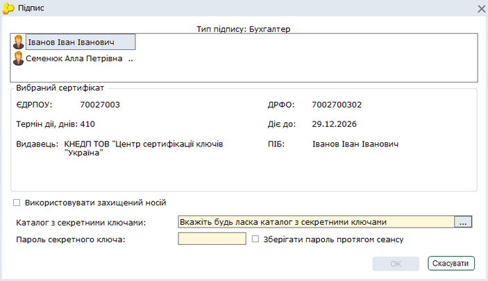
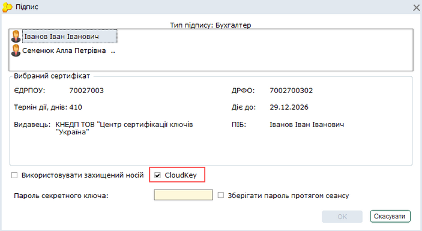
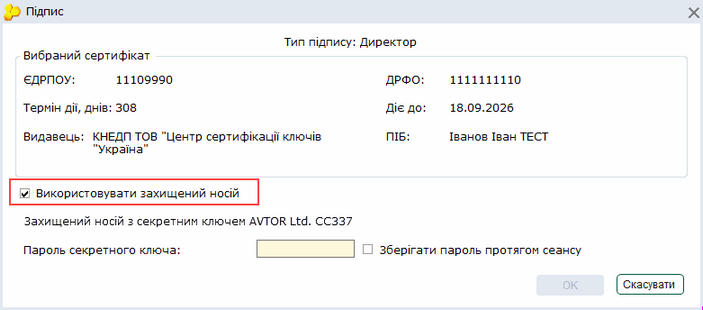
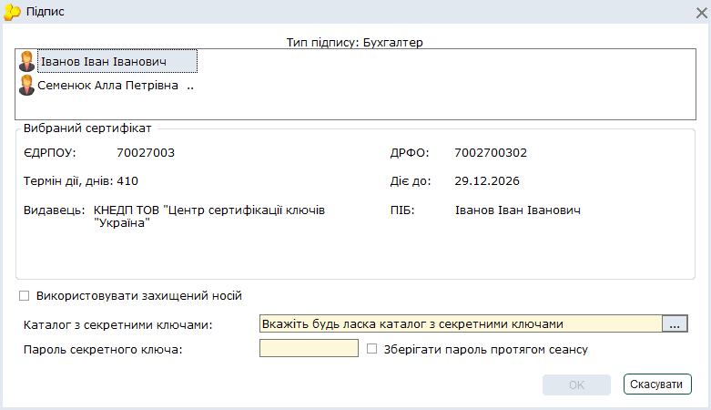
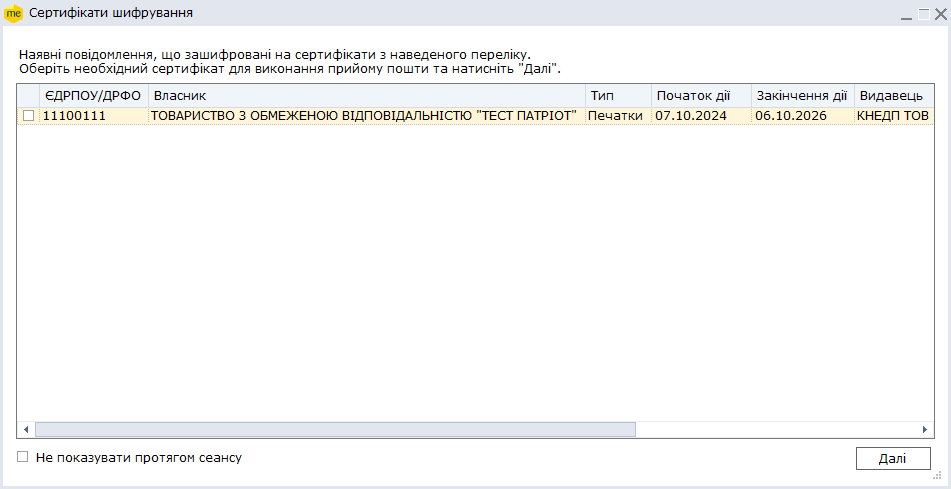
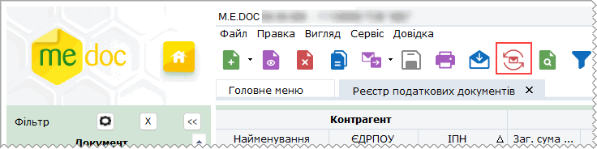
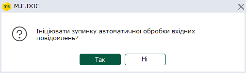

[← Зміст довідки](../)


# Підписання документів ЕП та їх відправлення

## Підписання документів ЕП та їх відправлення

_Шлях у довідці: Основні робочі процедури › Підписання документів ЕП та їх відправлення_

В цьому розділі:

[Що потрібно зробити перед підписанням документів ЕП та їх відправленням?](#uc_ecp-ecp)

[Підписання звітів електронним підписом](#uc_ecp-ecp)

[Підписання звітів за допомогою секретного ключа, що зберігається на захищеному носії](#uc_ecp-ecp)

[Відправлення документів у контролюючі органи та контрагентам](#uc_ecp-ecp)

[Відправлення звітів у контролюючі органи за умови відсутності мережі Інтернет](#uc_ecp-ecp)

[Отримання вхідних повідомлень](#uc_ecp-ecp)

[Автоматичний прийом повідомлень](#uc_ecp-ecp)

[Синхронізація вхідних та вихідних документів у екземплярах програми](#uc_ecp-ecp)

Всі електронні звіти, які подаються у державні звітні органи або відправляються контрагентам, повинні підписуватись ЕП посадових осіб та печатки (наявними в установі) та шифруватись сертифікатом звітного органу або контрагента.

У програмному комплексі ПК M.E.Doc вбудовані криптографічні бібліотеки, тому підпис та шифрування звітів реалізовані безпосередньо в програмі.

Всі звіти, які відправляються, повинні підписуватись електронними підписами (ЕП).

Зі скороченим переліком КНЕДП, сертифікати яких підтримуються, ви можете ознайомитись на нашому сайті за посиланням: [https://www.medoc.ua/uk/faq/jak-resursi-neobhdn-dlja-roboti-medoc](https://www.medoc.ua/uk/faq/jak-resursi-neobhdn-dlja-roboti-medoc).

Що потрібно зробити перед підписанням документів ЕП та їх відправленням?

Безпосередньо перед першим підписанням ЕП документа та його відправленням необхідно виконати підготовчі дії:

1. [Завантажте у програму сертифікати](UCAsignCert.html#ucasigncert-admcert_cert), отримані в одному з КНЕДП.

   Обов'язково переконайтесь, що сертифікати дійсні, тобто термін дії сертифікатів не закінчився.
    Нагадуємо, недійсні сертифікати виділяються червоним кольором.

2. [Налаштуйте комплекти підписів](FormCompanyParams.html#formcompanyparams-admcomanyparams_pen) відповідальних осіб.

3. Для відправлення документів електронною поштою [налаштуйте електронну пошту](FormCompanyParams.html#formcompanyparams-admcompanyparams_emaile).

4. [Створіть](UCDocRstByPer5.html#ucdocrstbyper5-rdoc_robota_stvor), заповніть та перевірте документ.

[До початку](#uc_ecp-ecp)

Підписання документів електронним підписом

Послідовність накладення підписів регламентується нормативними документами, які розроблені та затверджені кожним звітним органом.

Для роботи з усіма сертифікатами у програмі використовується універсальна бібліотека, тому процедура підпису для всіх сертифікатів однакова.

1. Після передачі документа на підпис, відкриється вікно Підпис.

2. Оберіть сертифікат відповідальної особи потрібного КНЕДП.

Кількість сертифікатів відповідальної особи залежить від кількості сертифікатів, наявних в модулі [Сертифікати](UCAsignCert.html#ucasigncert-admcert_cert).

Якщо ви зберігаєте секретний ключ у провайдера довірчих послуг у хмарному сховищі CloudKey, встановіть відмітку CloudKey:

Відмітка CloudKey доступна у вікні Підпис у разі, якщо у програму [завантажено сертифікат](UCAsignCert.html#ucasigncert-admcert_cert), секретний ключ до якого зберігається у хмарному сховищі.

Докладно про замовлення та збереження секретного ключа у захищеному у хмарному сховищі дивіться у розділі [Заявки на сертифікати](UCAsignCert.html#ucasigncert-admcert_basic).

- Підписання документа, якщо на підприємстві декілька посадових осіб з правом підпису

У вікні може бути представлений список сертифікатів декількох посадових осіб, якщо він був [сформований при налаштуванні комплектів підписів](FormCompanyParams.html#formcompanyparams-admcomanyparams_pen).

Оберіть прізвище особи, сертифікатом якої необхідно підписати даний документ.

3. У полі Каталог з секретними ключами вкажіть шлях до каталогу, в якому розміщені секретні ключі.

Секретний ключ - це файл із розширенням \*.zs2 (КНЕДП "Україна") або \*.dat (КНЕДП ІДД ДПС, КНЕДП "Masterkey"), який був згенерований під час [формування заявки на отримання сертифікатів ЕП](UCAsignCert.html#ucasigncert-admcert_req).

4. У поле Пароль секретного ключа введіть пароль секретного ключа, який Ви вводили при генерації заявки на сертифікат.

При вводі паролю зверніть увагу на розкладку клавіатури, а також на Caps Lock - вони мають співпадати з тим, що було при генерації заявки.

5. Якщо встановити галочку у полі Зберігати пароль протягом сеансу, то при наступному підписанні даним сертифікатом в межах поточного сеансу користування дана процедура виконається автоматично.

6. Натисніть ОК для продовження.

7. Почергово повторіть процедуру підпису всіма потрібними ЕП згідно з [налаштованим комплектом підписів](FormCompanyParams.html#formcompanyparams-admcomanyparams_pen).

8. Звіт набуває стану Підписаний, очікує відправки. Тепер документ можна відправляти у контролюючий орган або контрагенту.

[До початку](#uc_ecp-ecp)

Підписання документів за допомогою секретного ключа, що зберігається на захищеному носії

Щоб підписати документ за допомогою захищеного носія:

1. Оберіть сертифікат відповідальної особи потрібного КНЕДП.

2. Підключіть носій з секретним ключем обраного сертифікату до комп'ютера.

3. У вікні Підпис встановіть опцію Використовувати захищений носій.

Захищений носій з секретним ключем, що відповідає обраному підпису, повинен бути підключений до комп'ютера. Якщо носій не знайдено, або ключ не відповідає обраному підпису, у вікні Підпис з'явиться повідомлення про помилку.

Зверніть увагу! Для кожного типу підпису використовується окремий захищений носій!

4. У полі Пароль до носія введіть пароль доступу до захищеного носія. Натисніть ОК.

Будьте уважними! Кількість спроб вводу пароля обмежено виробником носія. У разі перевищення ліміту спроб захищений носій буде очищено.

5. Почергово повторіть процедуру підпису всіма потрібними ЕП згідно з [налаштованим комплектом підписів](FormCompanyParams.html#formcompanyparams-admcomanyparams_pen). Для кожного типу підпису необхідно підключити захищений носій з відповідними секретними ключами.

6. Звіт набуває стан Готовий до подачі. Тепер документ можна відправляти у контролюючий орган або контрагенту.

Зберегти секретний ключ на захищений апаратний носій можливо у розділі [Адміністрування - Сертифікати](UCAsignCert.html#ucasigncert-admcert_req_protekt).

[До початку](#uc_ecp-ecp)

Відправлення документів у контролюючі органи та контрагентам

Підписані комплектом підписів документи готові до відправлення у контролюючі органи або контрагентам.

Підписати документи можна із реєстру документів, при цьому способі можна підписувати групу документів, або безпосередньо із відкритого документа – тільки обраний документ.

- Відправлення документів із Реєстру

Відправлення документів відбувається у наступній послідовності:

1. Виділіть потрібний для відправлення документ у таблиці.

У програмі можна відправити як одн документ, так і групу документів одночасно. Для групової відправки документів виділіть їх у реєстрі курсором миші, утримуючіі клавіші Ctrl або Shift.

2. Скористайтесь одним із наступних способів:

- на панелі інструментів натисніть кнопку Відправити -
- оберіть команду головного меню Файл - Відправити;
- із контекстного меню оберіть команду Відправити;
- на панелі вкладок звіту оберіть закладку Наступні дії і натисніть Відправити у контролюючий орган.
Зверніть увагу! В залежності від типу документа (податкова накладна, первинний документ, фінансовий або статистичний звіт) на вкладці Наступні дії назва команди відправки документа може відрізнятись.

3. На виконання команди Відправити відкриється вікно Вибір адресата. Оберіть адресу контролюючого органу та натисніть на кнопку ОК.

4. На виконання цієї команди, система запропонує підписати файл будь-яким сертифікатом шифрування з комплекту підписів, що [налаштований](FormCompanyParams.html#formcompanyparams-admcomanyparams_pen) для певного типу документів.

Якщо при підписанні у вікні Підпис була встановлена галочка у полі Зберігати пароль протягом сеансу та, якщо в розділі Параметри системи - Підпис встановлена опція Використовувати пароль останнього підпису для ключа шифрування, то дана процедура виконається автоматично в межах поточного сеансу роботи.

При відправці електронних документів контрагентам програма автоматично відправлятиме документ на адресу зазначеного у документі контрагента, що зберігається у Адресній книзі. Докладно про можливі способи відправки електронних документів контрагентам дивіться розділ [Реєстр електронних документів](UCDFDocsRstNew.html#ucdfdocsrstnew-ucdfdocsrstnew).

Можна відправляти, погоджувати/відхиляти первинні документи, а також, отримувати відповіді щодо [погоджених/відхилених](PDocs_reestr_funkc.html#pdocs_reestr_funkc-pdocs_reestr_funkc_pryyom) документів, з використанням тільки сертифікатів відповідальних осіб. Для цього під час відправки документів у вікні вибору сертифіката шифрування потрібно обрати будь-який з доступних сертифікатів відповідальної особи, відповідно до [налаштованого комплекту](FormCompanyParams.html#formcompanyparams-admcomanyparams_pen) підписів певного типу документів.

5. Повідомлення відправлено.

- Відправлення документа із вікна відкритого документа

Із відкритого документа відправляється тільки обраний документ.

Для відправлення документа на панелі вкладок звіту оберіть закладку Наступні дії і натисніть Відправити у контролюючий орган.

Зверніть увагу! В залежності від типу документа (податкова накладна, первинний документ, фінансовий або статистичний звіт) на вкладці Наступні дії назва команди відправки документа може відрізнятись.

[До початку](#uc_ecp-ecp)

Відправлення звітів у контролюючі органи за умови відсутності мережі Інтернет

За умови відсутності мережі Інтернет на комп'ютері із встановленою програмою, передбачена функція Зашифрувати та зберегти, на виконання якої формується файл звіту для відправлення його у додатку до електронного листа з іншого комп'ютера з доступом до Інтернет.

1. Виділіть потрібний для шифрування документ.

Є можливість зашифрувати як один звіт, так і групу звітів одночасно (кожен файл шифрується окремо). Для групового шифрування записів реєстру виділіть потрібні курсором миші, використовуючи стандартні методи виділення декількох записів ОС Windows.

2. Оберіть одним із наступних способів:

- команда Файл - Зашифрувати та зберегти;
- із контекстного меню команда Зашифрувати та зберегти;
- на панелі вкладок звіту оберіть закладку Наступні дії і натисніть Зашифрувати та зберегти.

3. Відкриється вікно Вибір адресата. Оберіть адресу контролюючого органу, якому буде надіслано звіт, та натисніть на кнопку ОК.

4. Розпочнеться стандартна [процедура підпису документа електронним підписом](#uc_ecp-ecp).

5. У наступному вікні оберіть носій (каталог) для збереження підписаного та зашифрованого файлу звіту.

6. Після цього потрібно на комп’ютері із доступом в Інтернет створити лист на адресу контролюючого органу, в додаток до нього помістити збережений та зашифрований файл звіту. Відправити лист.

На відправлений звіт потрібно отримати електронну квитанцію із контролюючого органу та завантажити її у M.E.Doc.

Для завантаження квитанції, отриманої стороннім поштовим клієнтом, скористайтесь командою Файл - Імпорт - Імпорт квитанцій.

[До початку](#uc_ecp-ecp)

Отримання вхідних повідомлень

[Квитанції про обробку звітів](UCPravila.html#ucpravila-pravyla), відправлені контрагентом первинні документи, документи від контролюючих органів тощо надходять як звичайна вхідна кореспонденція.

Отримати повідомлення (перевірити наявність вхідних повідомлень) можливо, скориставшись одним із способів:

- на панелі інструментів кнопкою
- із меню Файл - Отримати повідомлення;
- за допомогою клавіші F9.

Програма запропонує обрати сертифікат для розшифрування вхідних повідомлень:

У відповідних полях оберіть каталог з секретними ключами, введіть пароль та натисніть ОК.

Якщо надійшли документи, для розшифровки яких потрібні додаткові сертифікати (крім обраного), відображатиметься вікно Сертифікати шифрування, що містить перелік додаткових сертифікатів:

У наведеному переліку встановіть відмітки для сертифікатів, що слід використовувати для розшифрування повідомлень, та натиснути кнопку Далі.

Зверніть увагу :

- для успішного розшифрування повідомлень з використанням додаткових сертифікатів у користувача повинні бути секретні ключі до даних сертифікатів;
- якщо у списку вікна Сертифікати шифрування не обрано жодного сертифіката, по натисканню кнопки Далі розшифрування повідомлень, що потребують застосування додаткових сертифікатів, не виконується.

При встановленій опції Не показувати протягом сеансу під час наступного прийому повідомлень не буде виконуватись запит додаткових сертифікатів. Дія опції триває до закінчення поточного сеансу роботи з програмою.

[До початку](#uc_ecp-ecp)

Автоматичний прийом повідомлень

У програмі можна налаштувати автоматичний прийом вхідних повідомлень, що виконується кожні 10 хвилин.

Щоб увімкнути автоматичний прийом, скористайтеся одним із способів:

- натисніть на панелі інструментів кнопку  Автоматичний прийом повідомлень;
- виконайте команду головного меню Файл – Автоматичний прийом повідомлень.

Програма запропонує обрати сертифікат для розшифрування вхідних повідомлень:

У відповідних полях оберіть каталог з секретними ключами, введіть пароль та натисніть ОК.

Після активації режиму автоматичного прийому кнопка Автоматичний прийом повідомлень на панелі інструментів змінить вигляд:

Для вимкнення функції автоматичного прийому повторно натисніть на кнопку  Зупинити автоматичний прийом повідомлень.

У вікні, що відкриється натисніть Так, щоб підтвердити вимкнення автоматичного прийому повідомлень:

Якщо надійшли документи, для розшифровки яких потрібні додаткові сертифікати (крім обраного), відображатиметься вікно Сертифікати шифрування, що містить перелік додаткових сертифікатів.

Також, прийняти вхідні повідомлення можна у будь-який момент часу за допомогою команди [Отримати повідомлення](#uc_ecp-ecp).

[До початку](#uc_ecp-ecp)

Синхронізація вхідних та вихідних документів у екземплярах програми

Користувачі, що використовують декілька екземплярів програми для роботи у одному підприємстві (під одним і тим самим кодом ЄДРПОУ), можуть налаштувати синхронізацію вхідних та вихідних первинних документів, ПН/РК, АН/РК та ТТН.

Синхронізація можлива для документів, обмін якими відбувається через платформу ПТАХ.

Для синхронізації документів у екземплярі програми необхідно встановити опцію Увімкнути синхронізацію документів з платформою ПТАХ у розділі [Адміністрування – Параметри системи – Документообіг](FormCompanyParams.html#formcompanyparams-admcompanyparams_sdo).

Під час прийому пошти у екземплярі програми виконується перевірка наявності вхідних та вихідних документів підприємства на сервері ПТАХ та завантаження цих документів у базу програми. Документи, у яких виконувались зміни (погодження відхилення, редагування, блокування тощо), заміщуються їх актуальними версіями.

Таким чином у екземплярі програми забезпечується набір актуальних документів підприємства, що оброблялись через платформу ПТАХ.

Зверніть увагу!

Синхронізація виконуватиметься лише для документів, що були відправлені/отримані після встановлення налаштувань у розділі [Адміністрування – Параметри системи – Документообіг](FormCompanyParams.html#formcompanyparams-admcompanyparams_sdo).

Також, у всіх екземплярах програми здійснюється отримання квитанцій з платформи ПТАХ. Якщо, у екземплярі програми отримано квитанцію на документ, який ще відсутній у базі даних, квитанція буде збережена у папці Incoming та прикріплена до документа після його завантаження у програму.

[До початку](#uc_ecp-ecp)


