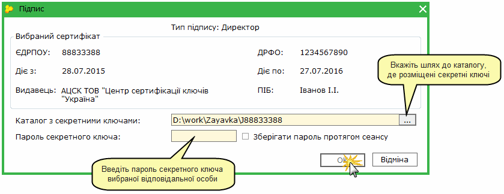
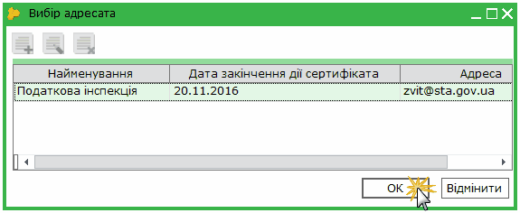

[← Зміст довідки](../)


# Підписання документів ЕЦП та їх відправлення

## Підписання документів ЕЦП та їх відправлення

_Шлях у довідці: Додатково: UC_ECP_DFS › Підписання документів ЕЦП та їх відправлення_

В цьому розділі:

[Що потрібно зробити перед підписанням документів ЕЦП та їх відправленням?](#uc_ecp_dfs-ecp)

[Підписання звітів електронним цифровим підписом](#uc_ecp_dfs-ecp)

[Відправлення документів у контролюючі органи](#uc_ecp_dfs-ecp)

[Відправлення звітів у контролюючі органи за умови відсутності мережі Інтернет](#uc_ecp_dfs-ecp)

Всі електронні звіти, які подаються у державні звітні органи або відправляються контрагентам, повинні підписуватись ЕЦП посадових осіб та печатки (наявними в установі) та шифруватись сертифікатом звітного органу або контрагенту.

У програмному комплексі ПК "M.E.Doc" вбудовані криптографічні бібліотеки, тому підпис та шифрування звітів реалізовані безпосередньо в програмі.

На поточний момент електронну звітність засобами телекомунікаційного зв'язку приймають наступні звітні органи:

- Державна фіскальна служба;
- Державна служба статистики;
- Державна служба зайнятості (ДСЗУ);
- Фонд соціального страхування з тимчасової втрати працездатності (ФСС з ТВП).

Звітність до ДФС, ФСС з ТВП та Державної служби статистики відправляється за прямим з'єднанням або електронною поштою (в залежності від налаштувань) безпосередньо із програми на Приймальні шлюзи цих органів, які називаються Центрами обробки електронних звітів (ЦОЕЗ).

Всі звіти, які відправляються засобами телекомунікаційного зв'язку, повинні підписуватись електронно-цифровими підписами (ЕЦП). У ПК "M.E.Doc" підтримуються сертифікати наступних акредитованих сертифікаційних центрів:

- АЦСК "Україна";
- АЦСК ІДД ДПС;
- АЦСК "Masterkey";
- АЦСК Держінформ'юст;
- АЦСК ТОВ НВФ "УНІС";
- АЦСК Українські спеціальні системи;
- АЦСК Укрзалізниця.

Що потрібно зробити перед підписанням документів ЕЦП та їх відправленням?

Безпосередньо перед першим підписанням ЕЦП документу та його відправленням необхідно налаштувати певні параметри системи для коректної роботи цього сервісу.

1. [Завантажте у програму сертифікати](UCAsignCert.html#ucasigncert-admcert_cert), отримані в одному з АЦСК.

  Обов'язково переконайтесь, що сертифікати дійсні, тобто термін дії сертифікатів не закінчився.
   Нагадуємо, недійсні сертифікати виділяються червоним кольором.

2. [Налаштуйте комплекти підписів](FormCompanyParams.html#formcompanyparams-admcomanyparams_pen) відповідальних осіб.

3. Для відправлення документів електронною поштою [налаштуйте вбудований поштовий клієнт](FormCompanyParams.html#formcompanyparams-admcompanyparams_emaile).

4. [Створіть](UCDocRstByPer5.html#ucdocrstbyper5-rdoc_robota_stvor), заповніть та перевірте документ.

[Наверх](#uc_ecp_dfs-ecp)

Підписання звітів електронним цифровим підписом

Послідовність накладення підписів регламентується нормативними документами, які розроблені та затверджені кожним звітним органом та зазвичай містяться у "Методичних рекомендаціях щодо централізованого приймання та комп’ютерної обробки звітності...".

Для роботи з усіма сертифікатами у програмі використовується універсальна бібліотека, тому процедура підпису для всіх сертифікатів однакова.

1. Після передачі звіту на підпис, відкриється вікно Підпис.

- Підписання документу, якщо на підприємстві декілька бухгалтерів або директорів з правом підпису

У вікні може бути представлений список сертифікатів посадових осіб, якщо він був [сформований при налаштуванні комплектів підписів](FormCompanyParams.html#formcompanyparams-admcomanyparams_pen).

Оберіть прізвище особи, сертифікатом якої необхідно підписати даний документ.

2. У полі Каталог з секретними ключами вкажіть шлях до каталогу, в якому розміщені секретні ключі.

Секретний ключ - це файл із розширенням \*.zs2 (АЦСК "Україна") або \*.dat (АЦСК ІДД ДФС, АЦСК "Masterkey"), який був згенерований під час [формування заявки на отримання сертифікатів ЕЦП](UCAsignCert.html#ucasigncert-admcert_req).

ПОРАДА: Якщо Ви забули, де були збережені секретні ключі під час їх генерації, скористайтесь функцією пошуку ОС Windows:
- натисніть на кнопку Пуск і виберіть пункт "Пошук";
- оберіть у полі "Пошук в:" Локальні диски (C;D);
- у полі "Ім'я файлу" вкажіть \*.zs2 або \*.dat;
- натисніть на кнопку Знайти.

3. У поле Пароль секретного ключа введіть пароль секретного ключа, який Ви вводили при генерації заявки на сертифікат.

ПОРАДА: При вводі паролю зверніть увагу на розкладку клавіатури, а також на Caps Lock - вони мають співпадати з тим, що було при генерації заявки.

4. Якщо встановити галочку у полі Зберігати пароль протягом сеансу, то при наступному підписанні даним сертифікатом в межах поточного сеансу користування дана процедура виконається автоматично.

5. Натисніть ОК для продовження.

6. Почергово повторіть процедуру підпису всіма потрібними ЕЦП згідно з [налаштованим комплектом підписів](FormCompanyParams.html#formcompanyparams-admcomanyparams_pen).

7. Звіт набуває стан Готовий до подачі. Тепер документ можна відправляти у контролюючий орган або контрагенту.

[Наверх](#uc_ecp_dfs-ecp)

Відправлення документів

Підписані комплектом підписів документи готові до відправлення у контролюючі органи або контрагентам.

Підписати документи можна із реєстру документів, при цьому способі можна підписувати групу документів, або безпосередньо із відкритого документу – тільки обраний документ.

- Відправлення документів із Реєстру

Відправлення документів відбувається у наступній послідовності:

1. Виділіть потрібний для відправлення документ у таблиці.

Реалізована можливість відправки як одного документа, так і групи документів одночасно. Для групової відправки документів виділіть їх у реєстрі курсором миші, використовуючи стандартні методи виділення декількох записів ОС Windows.

2. Скористайтесь одним із наступних способів:

- на панелі інструментів натисніть кнопку Відправити -
- оберіть команду Файл/Відправити;
- із контекстного меню оберіть команду Відправити;
- на панелі вкладок звіту оберіть закладку Наступні дії і натисніть Подати у контролюючий орган.
Зверніть увагу! В залежності від типу документа (податкова накладна, первинний документ, фінансовий або статистичний звіт) на вкладці "Наступні дії" назва команди відправки документу може відрізнятись.

3. Відкриється вікно Вибір адресата. Оберіть адресу потрібного контролюючого органу або контрагента та натисніть на кнопку ОК.

4. На виконання цієї команди, система запропонує підписати файл сертифікатом печатки установи - шифрування - таким чином підписується "конверт", в який поміщається файл для відправки.

Якщо при підписанні печаткою установи раніше була встановлена галочка у полі «Зберігати пароль протягом сеансу» та якщо в Параметрах системи > Підпис встановлена галочка в полі "Використовувати пароль останнього підпису для ключа шифрування", то дана процедура виконається автоматично в межах поточного сеансу користування.

5. Повідомлення відправлено. Звіт набуває стан В дорозі.

- Відправлення документу із вікна відкритого документа

Із відкритого документу відправляється тільки обраний документ.

Для відправлення документу на панелі вкладок звіту оберіть закладку Наступні дії і натисніть Подати у контролюючий орган.

Зверніть увагу! В залежності від типу документу (податкова накладна, первинний документ, фінансовий або статистичний звіт) на вкладці "Наступні дії" назва команди відправки документу може відрізнятись.

[Наверх](#uc_ecp_dfs-ecp)

Відправлення звітів у контролюючі органи за умови відсутності мережі Інтернет

За умови відсутності мережі Інтернет на комп'ютері із встановленою програмою, передбачена функція Зашифрувати та зберегти, на виконання якої формується файл звіту для відправлення його у додатку до електронного листа з іншого комп'ютера з доступом до Інтернет.

1. Виділіть потрібний для шифрування документ.

Є можливість зашифрувати як один звіт, так і групу звітів одночасно (кожен файл шифрується окремо). Для групового шифрування записів реєстру виділіть потрібні курсором миші, використовуючи стандартні методи виділення декількох записів ОС Windows.

2. Оберіть одним із наступних способів:

- команда Файл/Зашифрувати та зберегти;
- із контекстного меню команда Зашифрувати та зберегти;
- на панелі вкладок звіту оберіть закладку Наступні дії і натисніть Зашифрувати та зберегти.

3. Відкриється вікно Вибір адресата. Оберіть адресу контролюючого органу, якому буде надіслано звіт, та натисніть на кнопку ОК.

4. Розпочнеться стандартна [процедура підпису документу електронним цифровим підписом](#uc_ecp_dfs-ecp).

5. У наступному вікні оберіть носій (каталог) для збереження підписаного та зашифрованого файлу звіту.

6. Після цього потрібно на комп’ютері із доступом в Інтернет створити лист на адресу контролюючого органу, в додаток до нього помістити збережений та зашифрований файл звіту. Відправити лист.

На відправлений звіт потрібно отримати електронну квитанцію із контролюючого органу та завантажити її у "M.E.Doc".

ПОРАДА: Для завантаження квитанції, отриманої стороннім поштовим клієнтом, скористайтесь командою Файл/Імпорт/Імпорт квитанцій.

[Наверх](#uc_ecp_dfs-ecp)


