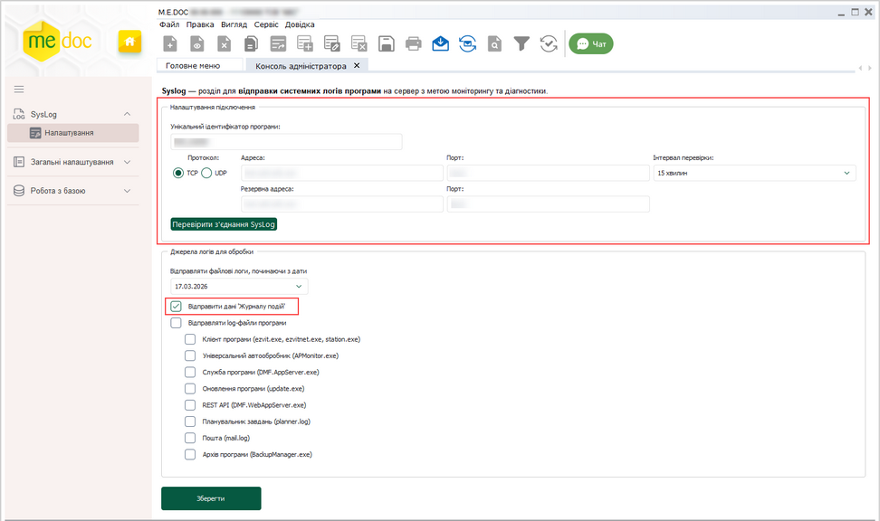
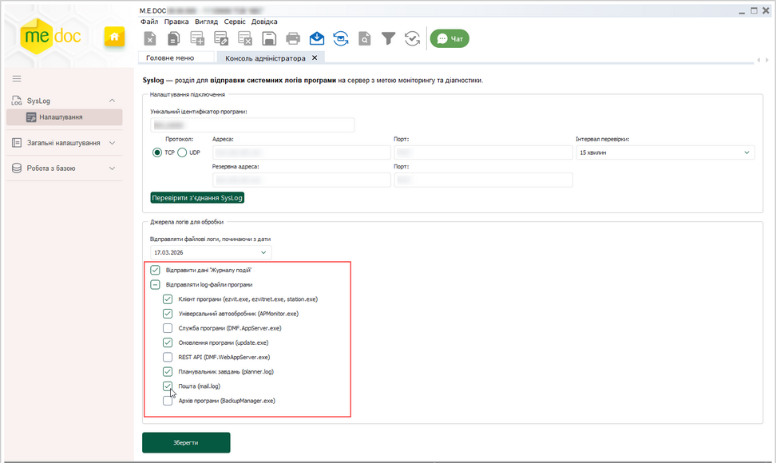
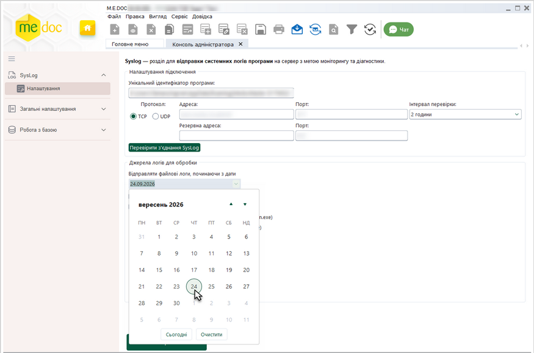
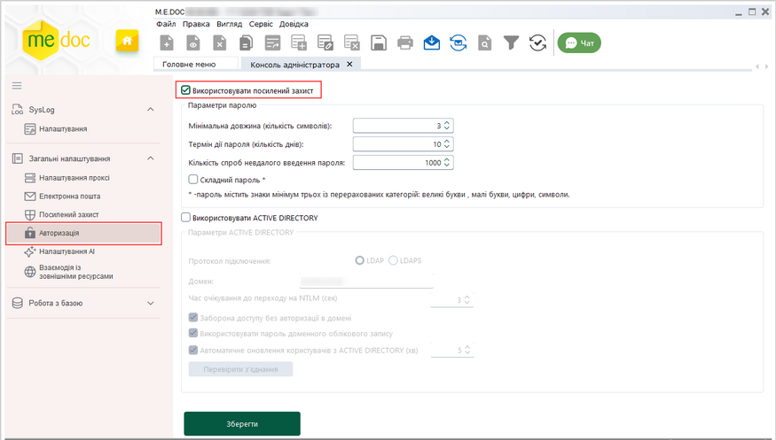
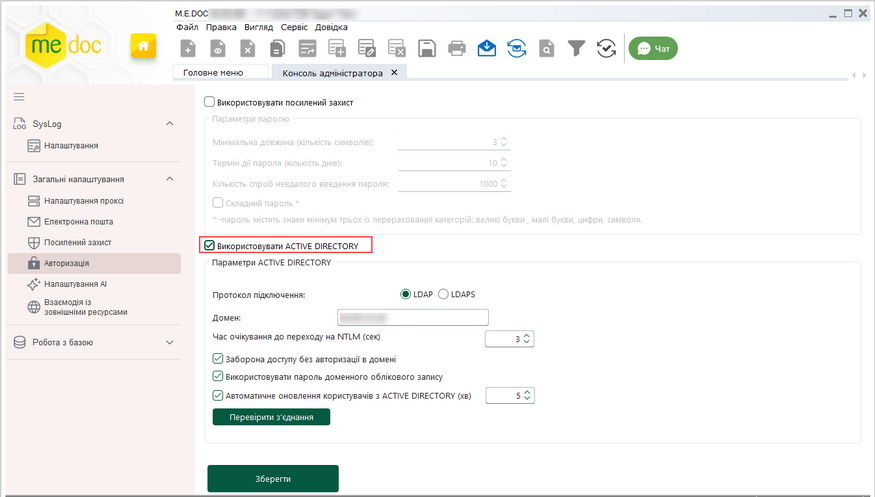
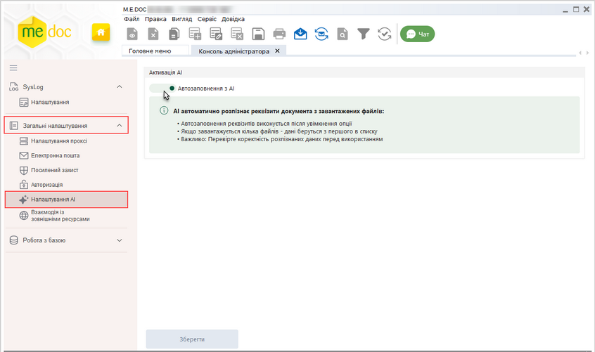
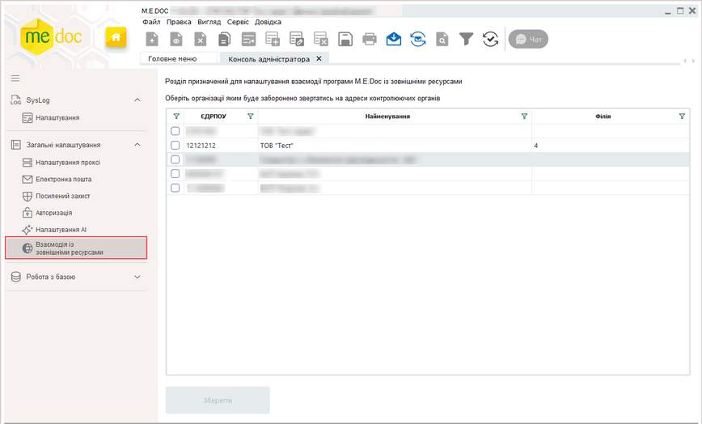
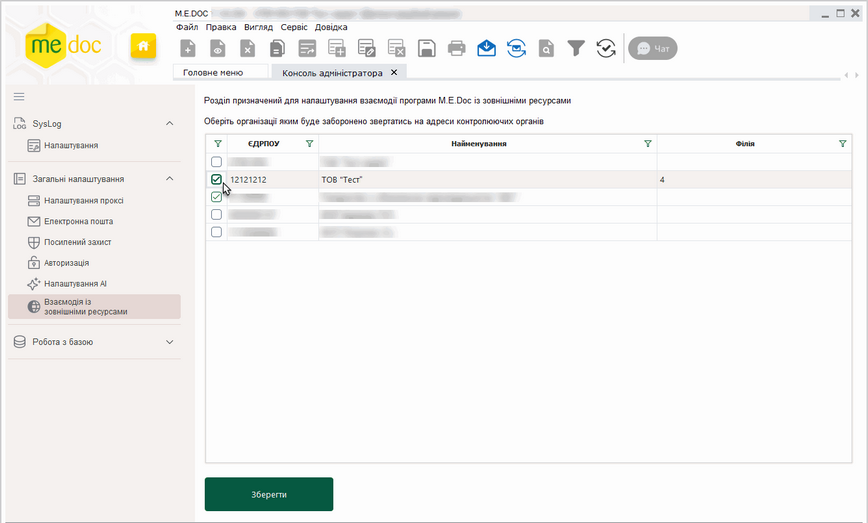
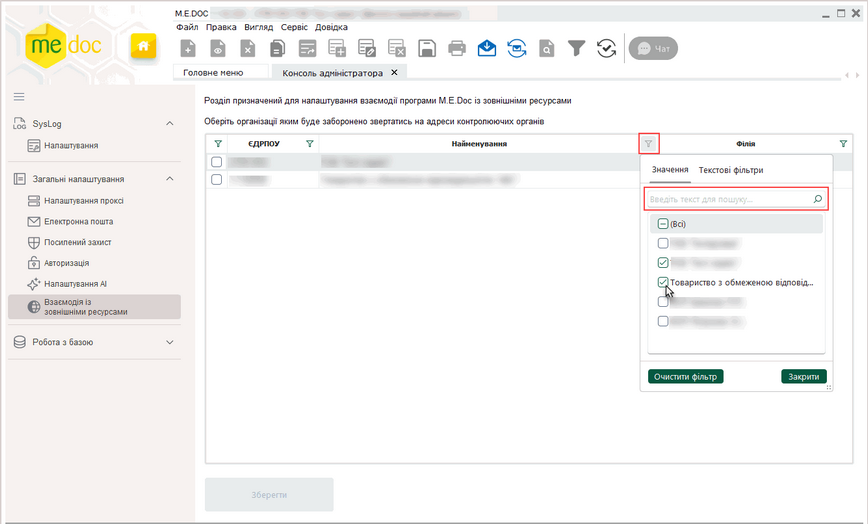
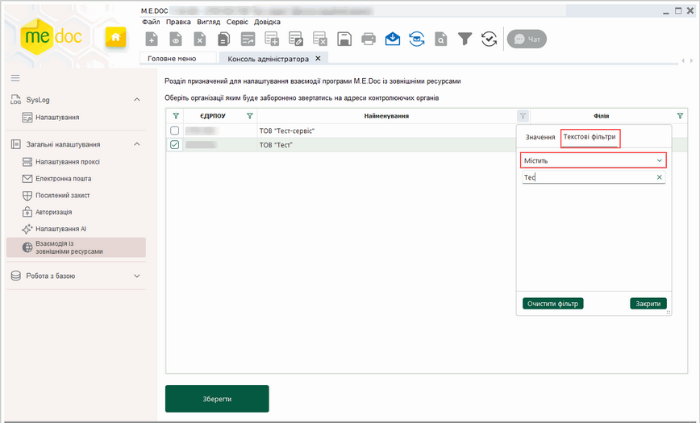

[← Зміст довідки](../)


# Консоль адміністратора

## Консоль адміністратора

_Шлях у довідці: Розділи програми › Адміністрування › Консоль адміністратора_

Модуль Консоль адміністратора надає інструменти для налаштування моніторингу і діагностики роботи програми.

Наразі у модулі доступні розділи:

- SysLog – налаштування відправки у форматі SysLog даних Журналу подій та лог-файлів програми.
- Загальні налаштування – загальні параметри роботи програми.

Доступ користувачів до модуля Консоль адміністратора налаштовується у розділі програми [Адміністрування – Управління ролями – Доступ до підсистем](UCManageRoles.html#ucmanageroles-ucmanageroles).

Можливості модуля Консоль адміністратора розширюватимуться в майбутніх оновленнях програми.

У даному розділі довідки розглянуто наступне:

[Розділ SysLog](#ucadmconsole-syslog)

- [Налаштування підключення](#ucadmconsole-syslog)
- [Налаштування автоматичної відправки на сервер Syslog даних Журналу подій та лог-файлів програми](#ucadmconsole-syslog)
- [Налаштування відправки log-файлів на сервер SysLog, починаючи з визначеної дати](#ucadmconsole-syslog)

[Загальні налаштування](#ucadmconsole-zagalni)

- [Авторизація](#ucadmconsole-zagalni)
- [Налаштування АІ](#ucadmconsole-zagalni)
- [Взаємодія із зовнішніми ресурсами](#ucadmconsole-zagalni)

### Розділ налаштувань SysLog

_Шлях у довідці: Розділи програми › Адміністрування › Консоль адміністратора › Розділ налаштувань SysLog_

В цьому розділі:

[Налаштування підключення](#ucadmconsole-syslog)

[Налаштування автоматичної відправки на сервер Syslog даних Журналу подій та лог-файлів програми](#ucadmconsole-syslog)

[Налаштування відправки log-файлів на сервер SysLog, починаючи з визначеної дати](#ucadmconsole-syslog)

Розділ SysLog надає інструменти для налаштування відправки у форматі SysLog даних Журналу подій та лог-файлів програми.

Налаштування підключення

У розділі SysLog можна налаштувати відправлення даних про роботу програми, що зафіксовані у Журналі подій, на сервер користувача. Дані передаються у форматі SysLog та стандарті RFC 5424.

Для цього:

1. Перейдіть у розділ Адміністрування – Консоль адміністратора - SysLog - Налаштування підключення.

2. Налаштуйте параметри з’єднання у наступних полях:

- Унікальний ідентифікатор програми - надає можливість визначити, з якої саме програми надіслані системні логи та дані Журналу подій на сервер користувача, за замовчуванням встановлюється ідентифікатор, що містить шлях встановлення програми, назву комп'ютера та IP-адресу комп'ютера, у разі потреби, введіть власний ідентифікатор програми;
- Протокол – TCP або UDP (оберіть потрібний варіант, встановивши відповідну опцію);
- Адреса – введіть адресу сервера SysLog;
- Порт – вкажіть порт сервера SysLog.
- Інтервал перевірки – зі списку оберіть період, через який дані [надсилатимуться автоматично](#ucadmconsole-syslog);

При використанні протоколу TCP можна налаштувати відправку даних на резервну адресу, у разі якщо основна адреса недоступна. При виборі протоколу TCP на вкладці модуля стають доступними поля: Резервна адреса та Порт. Щоб відправляти дані на резервну адресу, у разі якщо основна адреса недоступна у полях:

- Резервна адреса - введіть адресу резервного сервера SysLog (за наявності);
- Порт - вкажіть порт резервного сервера SysLog (за наявності).

Відправка даних здійснюється за наступним алгоритмом:

1. Якщо вибрано протокол TCP, програма перевіряє доступність основної адреси під час відправки;

2. Якщо основна адреса недоступна і заповнені поля резервної адреси, дані відправляються на резервну адресу;

3. Якщо поля резервної адреси порожні або резервна адреса теж недоступна, відправка не виконується.

Перевірка доступності основної адреси виконується при кожному сеансі відправки даних.

Натисніть, щоб збільшити малюнок

3. Для перевірки налаштувань натисніть кнопку Перевірити з’єднання SysLog. Програма повідомить про результат перевірки.

4. Натисніть кнопку Зберегти для збереження виконаних налаштувань.

[До початку](#ucadmconsole-syslog)

Налаштування автоматичної відправки на сервер Syslog даних Журналу подій та лог-файлів програми

Для налаштування передачі даних Журналу подій у області Джерела логів для обробки встановіть відмітку Відправити дані «Журналу подій».

Для налаштування передачі лог-файлів оберіть джерела логів, встановивши відповідні опції у розділі Консоль адміністратора – Джерела логів для обробки – Відправляти log-файли програми (щоб швидко обрати або видалити всі опції, встановіть або видаліть опцію Відправляти log-файли програми.):

Натисніть, щоб збільшити малюнок

Натисніть кнопку Зберегти для збереження виконаних налаштувань.

Для клієнт-серверного варіанту роботи програми:

Відправка лог-файлів на сервер Syslog здійснюється централізовано – на сервері програми:

- Налаштовані джерела логів із заданою періодичністю передають власні лог-файли у каталог \SysLog, який розміщується в кореневому каталозі серверної частини програми M.E.Doc. Цей каталог використовується тільки для акумулювання логів, які в подальшому будуть передані на сервер Syslog. Періодичність, з якою передаватимуться лог-файли, встановлюється у полі Інтервал перевірки у області налаштувань Налаштування підключення.
- Для запобігання дублюванню інформації використовується службовий файл logsync.json. Він створюється на джерелі, для якого налаштували передачу лог-файлів на сервер Syslog.
- Для збереження інформації про файли, які вже були відправлені, створюється новий лог-файл SyslogDMFAppServer.log (на сервер Syslog не відправляється).
- Відправка файлів із каталогу \SysLog на сервер Syslog здійснюється із встановленою періодичністю (поле Інтервал перевірки у області налаштувань Налаштування підключення).

Для локального варіанту роботи програми:

Відправка лог-файлів виконується безпосередньо з робочого місця користувача на сервер Syslog.

[До початку](#ucadmconsole-syslog)

Налаштування відправки log-файлів на сервер SysLog, починаючи з визначеної дати

Для налаштування відправки log-файлів на сервер SysLog, починаючи з визначеної дати, у області налаштувань Джерела логів для обробки у полі Відправляти файлові логи, починаючи з дати оберіть дату, з якої слід розпочати відправлення інформації (за замовчуванням встановлено поточну дату):

Натисніть, щоб збільшити малюнок

На сервер SysLog буде відправлятися інформація, що була збережена, починаючи з обраної дати.

Натисніть кнопку Зберегти для збереження виконаних налаштувань.

[До початку](#ucadmconsole-syslog)

### Загальні налаштування

_Шлях у довідці: Розділи програми › Адміністрування › Консоль адміністратора › Загальні налаштування_

В цьому розділі:

[Авторизація](#ucadmconsole-zagalni)

- [Налаштування посиленого захисту](#ucadmconsole-zagalni)
- [Налаштування використання ACTIVE DIRECTORY](#ucadmconsole-zagalni)

[Налаштування АІ](#ucadmconsole-zagalni)

[Взаємодія із зовнішніми ресурсами](#ucadmconsole-zagalni)

Розділ Загальні налаштування надає інструменти для налаштування параметрів роботи програми, таких як: використання посиленого захисту, авторизації та налаштувань користувачів з ACTIVE DIRECTORY, налаштування автозаповнення Універсальних документів за допомогою АІ, взаємодія з іншими ресурсами.

Авторизація

Підрозділ призначений для встановлення використання:

- посиленого захисту авторизації;

або

- налаштування та прав користувачів з ACTIVE DIRECTORY.
- Одночасно можна обрати тільки одну групу налаштувань.

Налаштування посиленого захисту

Для того, щоб активувати використання посиленого захисту авторизації в M.E.Doc:

Перейдіть у розділ Загальні налаштування – Авторизація та встановіть позначку в полі Використовувати посилений захист.

Натисніть, щоб збільшити малюнок

Стають доступними наступні налаштування:

- Мінімальна довжина (кількість символів)
Вкажіть мінімальну довжину пароля секретного ключа (поле приймає значення в діапазоні 0-32).
Для вимкнення опції введіть "0" або залиште поле порожнім (пароль для входу не потрібний).
Увага! Наступний пароль не може бути таким самим, як попередній. При зміні пароля встановити порожній пароль два рази підряд буде неможливо.

- Термін дії пароля (кількість днів)
Кількість днів, протягом яких діє встановлений користувачем пароль (поле приймає значення в діапазоні 0-1000 днів).
За замовчуванням встановлено значення 45 днів.
Для вимкнення опції введіть "0" (необмежений термін дії пароля).

- Кількість спроб невдалого введення паролю
Вкажіть кількість спроб некоректного введення паролю, після яких користувач більше не зможе увійти в програму в поточному сеансі.
Для вимкнення опції введіть "0" (необмежена кількість спроб).

- Складний пароль
Встановіть ознаку, якщо пароль повинен бути складним, тобто включати символи хоча б трьох категорій з:

- великі букви;
- малі букви;
- цифри;
- інші символи.

Для збереження внесених змін натисніть Застосувати.

Після першої активації якщо встановлений термін дії пароля, ВСІ користувачі повинні будуть змінити паролі згідно встановлених налаштувань.

У випадку, якщо термін дії пароля не встановлений, при вході користувачі не отримають запит на зміну простого пароля на складний.
Далі запит на зміну пароля буде з'являтись користувачам в залежності від терміну дії пароля.

Вікно зміни пароля

При введенні користувачем пароля при вході в програму відобразиться вікно зміни пароля із вимогами до пароля в залежності від встановлених налаштувань (мінімальна довжина та/або складність пароля).

- Без зміни пароля подальша робота буде неможливою
- Увага! Наступний пароль не може бути таким самим, як попередній

У вікні зміни пароля введіть старий та новий паролі у відповідні поля та натисніть кнопку ОК.

[До початку](#ucadmconsole-zagalni)

Налаштування використання ACTIVE DIRECTORY

Для того, щоб активувати використання налаштування та прав користувачів з ACTIVE DIRECTORY:

Перейдіть у розділ Загальні налаштування – Авторизація та встановіть галочку в полі Використовувати ACTIVE DIRECTORY.

Натисніть, щоб збільшити малюнок

Стають доступними наступні налаштування:

- Протокол підключення

оберіть варіант підключення - встановіть відповідну опцію: LDAP або LDAPS.

Для встановлення захищеного з’єднання використовується SSL/TLS-сертифікат, налаштований на сервері Active Directory (контролері домену). Сертифікат має бути чинним і довіреним на комп’ютері, з якого виконується підключення.

- Домен
Вкажіть назву домена.

- Час очікування до переходу на NTLM (сек)

вкажіть, скільки часу (у секундах) програма очікуватиме на завершення автентифікації за допомогою Kerberos, якщо протягом указаного часу автентифікацію не виконано, програма автоматично переходить до спроби автентифікації за допомогою NTLM.

Автентифікації користувачів у доменній інфраструктурі Active Directory за замовчуванням здійснюється із використанням протоколу Kerberos - для автентифікації використовується механізм Negotiate, який у доменному середовищі надає пріоритет Kerberos. (Механізм дає змогу використовувати доменні облікові дані користувача, під якими він виконав вхід до операційної системи, для авторизації у програмі.) У випадках, коли Kerberos недоступний або не може бути використаний, через зазначений проміжок часу здійснюється автоматичний перехід на NTLM.

- Заборона доступу без авторизації в домені
Якщо опцію не встановлено, то користувач, відсутній в домені, зможе авторизуватись під користувачем, зареєстрованим в M.E.Doc.
Встановіть ознаку для обмеження входу користувачам, незареєстрованим в домені. В цьому випадку незареєстрований користувач зможе увійти до програми тільки під логіном адміністратора.

- Використовувати пароль доменного облікового запису
Якщо опцію встановлено, виконується перевірка пароля користувача Active Directory при авторизації у програмі M.E.Doc. При авторизації у програмі, у вікні вибору користувача, необхідно обрати ім’я користувача та ввести пароль поточного користувача Active Directory. Буде виконано перевірку відповідності введеного пароля. Якщо результат перевірка негативний, виводиться повідомлення про некоректно введені логін та пароль, вхід у програму не виконується.

Якщо опцію не встановлено, авторизація користувача буде відбуватись автоматично, тобто при вході в M.E.Doc не буде відображатись вікно авторизації користувача в системі, а одразу вікно Вибір установи.

- Автоматичне оновлення користувачів з ACTIVE DIRECTORY (хв)
Якщо опцію встановлено, виконується порівняння даних облікових записів користувачів у базі програми з даними користувачів з ACTIVE DIRECTORY та за результатами перевірки автоматично здійснюється оновлення існуючих облікових записів, видалення записів з групи у програмі, якщо вони відсутні у ACTIVE DIRECTORY, переміщення облікових записів у іншу групу, додавання нових користувачів.

Автоматичне оновлення облікових записів здійснюється при кожній авторизації у програмі, під час роботи програми оновлення виконується із зазначеним часовим інтервалом. Щоб встановити періодичність оновлення, введіть часовий інтервал у хвилинах у полі нижче.

Зверніть увагу, оновлення даних виконується лише для існуючих груп користувачів. Щоб додати групу користувачів у програму, у розділі Адміністрування – Управління користувачами необхідно виконати команду [Імпортувати групу з AD](UCAdminUsers.html#ucadminusers-admusr).

Для збереження внесених змін натисніть Застосувати.

[До початку](#ucadmconsole-zagalni)

Налаштування АІ

У розділі можна керувати розумним функціоналом автоматичного заповнення реквізитів [Універсальних документів із вкладеннями](Doc_Dov_Form.html#doc_dov_form-doc_dov_form) за допомогою штучного інтелекту (ШІ).

Для цього:

1. Перейдіть у розділ Загальні налаштування – Налаштування АІ.

2. Увімкніть перемикач Автозаповнення з АІ, щоб дозволити використання ШІ при створенні та заповненні Універсальних документів. Або вимкніть перемикач, якщо використання ШІ потрібно заборонити:

Натисніть, щоб збільшити малюнок

- Перемикач доступний за наявності ліцензії Електронний документообіг та увімкнений за замовчуванням. У разі, якщо ліцензія відсутня, перемикач недоступний та вимкнений.
- Докладно про використання ШІ для створення Універсальних документів дивіться у розділі [Створення Універсального документа із вкладеннями за допомогою ШІ](Doc_Dov_Form.html#doc_dov_form-doc_dov_form).

3. Натисніть кнопку Зберегти для збереження виконаних налаштувань.

[До початку](#ucadmconsole-zagalni)

Взаємодія із зовнішніми ресурсами

У розділі можна налаштовувати взаємодію програми M.E.Doc із зовнішніми ресурсами.

Наразі у модулі для вибраних організацій можна дозволити або обмежити звернення до шлюзів контролюючих органів під час отримання пошти, відправки звітів, а також заборонити виконання операцій, що потребують звернення до API контролюючих органів.

За замовчуванням взаємодію з контролюючими органами для всіх підприємств дозволено.

Для налаштування:

1. Перейдіть у розділ Загальні налаштування – Взаємодія із зовнішніми ресурсами.

Натисніть, щоб збільшити малюнок

2. Оберіть підприємства, для яких потрібно налаштувати заборону взаємодії, встановивши позначки на початку рядка:

Натисніть, щоб збільшити малюнок

Щоб швидко знайти потрібні підприємства, скористайтеся фільтром у заголовку таблиці. Відфільтрувати дані підприємств можна за значенням коду ЄДРПОУ, назвою та номером філії.

Натисніть іконку  та у списку встановіть відмітки біля потрібного значення, наприклад, назв підприємств. Щоб знайти потрібні значення у списку, скористайтеся рядком пошуку:

Натисніть, щоб збільшити малюнок

Також можна знайти потрібні підприємства, ввівши значення параметрів вручну. Для цього оберіть Текстові фільтри. Далі оберіть умову пошуку (починається, містить тощо) та почніть вводити потрібне значення. Для пошуку потрібно ввести не менше 3-х символів:

Натисніть, щоб збільшити малюнок

3. Натисніть кнопку Зберегти для збереження виконаних налаштувань.

Для вибраних підприємств буде заблоковано звернення до шлюзів контролюючих органів та відправка документів на адреси контролюючих органів як у ручному режимі, так і під час автоматичної обробки документів.

Важливо!

При активованому налаштуванні також буде недоступне виконання окремих операцій, що потребують звернення до API або шлюзів контролюючих органів, зокрема:

- у модулі Податкові довідки – Стан розрахунків з бюджетом – Оновити дані в єдиному довіднику контрагентів та Деталізація;
- у модулі Довідники – Контрагенти – при виконанні операції Оновити дані по контрагенту - дані контрагентів будуть оновлюватися виключно з ЄДК, оновлення даних контрагентів із ДПС буде недоступне;
- у модулі Облік ПДВ – Реєстр податкових документів – команда меню Правка – Перевірка платників ПДВ;
- у модулі Облік ПДВ – Створення податкових накладних на основі чеків – Завантажити чеки;
- у модулі Адміністрування – Параметри системи – Налаштування проксі – Перевірити з'єднання (Всі адреси).

Якщо користувач спробує виконати одну з таких операцій або відправити документи до контролюючих органів, програма повідомить про встановлену заборону взаємодії.

Якщо у розділі Адміністрування – Параметри системи – Документообіг налаштовано відправку через Сервер ДПС, при відправці контрагентам ПН, АН або РК буде виведено повідомлення з пропозицією відправити документи через платформу ПТАХ. По натисканню кнопки Так відправка документів буде виконана через платформу ПТАХ. По натисканню кнопки Ні – відправка документів скасовується.

[До початку](#ucadmconsole-zagalni)


