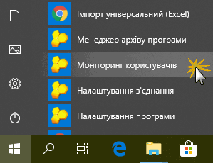
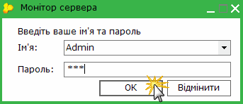
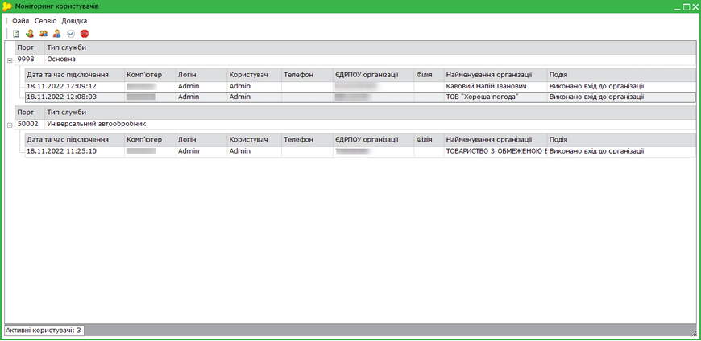
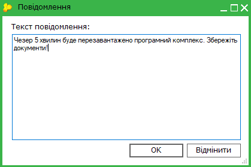
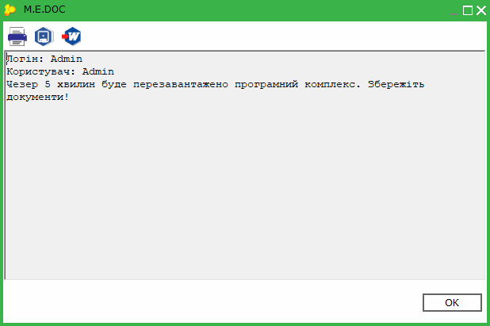
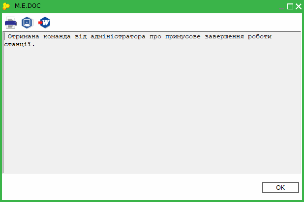
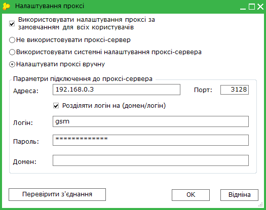
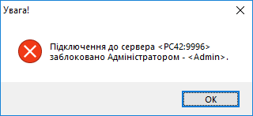

[← Зміст довідки](../)


# Моніторинг користувачів

## Моніторинг користувачів

_Шлях у довідці: Допоміжні сервіси › Моніторинг користувачів_

В цьому розділі:

[Запуск Моніторингу користувачів](#usersmonitor-usersmonitor)

[Функції Моніторингу користувачів](#usersmonitor-usersmonitor)

Моніторинг користувачів призначений для оновлення програмного комплексу, відслідковування активних сеансів користувачів, надсилання повідомлень, як одному користувачу, так і групі користувачів, виконання резервного копіювання в мережевій версії ПК M.E.Doc.

Запуск Моніторингу користувачів

Для того, щоб запустити Моніторинг користувачів оберіть меню Пуск - M.E.Doc Server  Моніторинг користувачів.

Запускати Моніторинг користувачів також можна за допомогою кнопки на робочому столі. Налаштувати створення кнопки для запуску Моніторинг користувачів можна при встановленні програми [на базі СКБД ORACLE](Help.html#help-setup_installation_program_oracle) або на базі [СКБД PostgreSQL](Help.html#help-setup_installation_program_postgresql).

Відкриється вікно авторизації користувача в системі. Введіть логін та пароль у однойменні поля та натисніть кнопку Ок.

Відкриється вікно додатку Моніторинг користувачів.

Моніторинг містить перелік активних робочих станцій. Якщо розгорнути запис робочої станції - відобразиться перелік операцій, які виконував користувач, та перелік звітів, які відкриті в поточний момент (відображаються лише звіти, які були збережені в базі програми).

Натисніть, щоб збільшити малюнок

[До початку](#usersmonitor-usersmonitor)

Функції Моніторингу користувачів

В Моніторингу користувачів передбачено наступні функції:

Оновити список активних станцій

Щоб бути впевненим, які саме робочі станції працюють і які саме користувачі увійшли в програмний комплекс у поточний момент часу, скористайтеся функцією оновлення списку активних станцій.

Для того щоб оновити список станцій, використайте один із наступних способів:

- у меню Файл оберіть команду Оновити список активних користувачів;
- натисніть кнопку  на панелі інструментів;
- натисніть функціональну клавішу F5.

Надіслати повідомлення, Надіслати повідомлення всім

Функції надсилання повідомлення призначені для комунікації між адміністратором програмного комплексу (користувачем, що має доступ до Моніторингу користувачів) та користувачами, що працюють за робочими станціями. Передбачена можливість оповіщення як обраних користувачів, так і всіх користувачів, що працюють за робочими станціями у поточний момент часу.

Для того щоб відправити повідомлення, скористайтесь одним із наступних способів:

|  |  |
| --- | --- |
| оповіщення обраних користувачів | оповіщення всіх користувачів |
| Виділіть за допомогою миші рядки, що відповідають обліковим записам користувачів, якім потрібно надіслати повідомлення. Щоб виділити кілька рядків, натисніть та утримуйте клавіші <Ctrl> або <Shift>.  - у меню Файл оберіть команду Надіслати повідомлення виділеним користувачам; | - у меню Файл оберіть команду Надіслати повідомлення всім користувачам  - натисніть кнопку  на панелі інструментів  - натисніть функціональну клавішу Ctrl+F6 |
| - натисніть кнопку   на панелі інструментів; |
| - натисніть функціональну клавішу F6 |

На виконання команди відкриється вікно Повідомлення. Введіть текст повідомлення, що потрібно відправити та натисніть кнопку ОК.

Користувачі отримають повідомлення:

У разі потреби, повідомлення можна роздрукувати, зберегти на жорсткому диску в зручному форматі або експортувати в Word.

Завершити сеанс станції

Функція призначена для завершення роботи станції.

Для того, щоб завершити роботу станції, скористайтеся одним із наступних способів:

- у меню Файл оберіть команду Завершити сеанс станції;
- натисніть кнопку   на панелі інструментів;
- натисніть функціональну клавішу F7.

Користувач отримає повідомлення:

Якщо користувач натисне Ні, система через певний проміжок часу знову запитає користувача про можливість закриття робочої станції. Система запитуватиме користувача до тих пір, поки користувач не натисне Так. Якщо протягом 30 секунд не буде натиснуто жодної з кнопок - робоча станція закриється автоматично.

Оновити програму

Так як на станціях вимкнена можливість безпосереднього оновлення з Інтернету, оновлення відбувається через додаток Моніторинг користувачів за допомогою функції оновлення програмного комплексу.

Для того, щоб оновити програму скористайтесь одним із наступних способів:

- у меню Файл оберіть команду Оновити програму;
- натисніть кнопку   на панелі інструментів;
- натисніть функціональну клавішу F9.

Налаштувати проксі

Для здійснення оновлення програми, система автоматично перевіряє з'єднання з мережею Інтернет. В разі відсутності прямого підключення до Інтернету, необхідно налаштувати параметри підключення до проксі-сервера.

Для того, щоб налаштувати проксі у меню Сервіс оберіть команду Налаштування проксі.

Відкриється вікно Налаштування проксі.

Ви можете використати системні налаштування проксі-сервера, встановивши відповідну опцію, або виконати налаштування вручну.

Для налаштування проксі-сервера вручну:

1. Встановіть опцію Налаштувати проксі вручну.

2. У полі Адреса вкажіть доменне ім'я або IP-адресу проксі-сервера.

3. У полі Порт вкажіть номер порту, який використовується проксі-сервером для підключень (за умовчанням встановлено значення 3128).

4. За умови використання авторизованого доступу до мережі Інтернет, введіть особисті дані користувача в поля Логін і Пароль та, за потреби, Домен.

5. Для перевірки правильності введених даних натисніть на кнопку Перевірити з'єднання. Система повідомить про успішне з'єднання або помилку.

6. Поле Використовувати налаштування проксі за замовчанням для всіх користувачів доступне лише під обліковим записом Admin.
Якщо встановлена дана позначка, у інших користувачів системи використовуються ті ж налаштування підключення до проксі-серверу, які встановлені під обліковим записом Admin, при цьому в облікових записах користувачів налаштування проксі блокуються.

Менеджер архіву програми

Призначено для повного резервного копіювання всіх бібліотек та бази програмного комплексу.

Для того, щоб виконати резервне копіювання програмного комплексу у меню Сервіс оберіть команду Менеджер архіву програми.

По виконанню команди система оповістить всіх користувачів про потребу завершення роботи робочих станцій, з можливістю варіанту вибору Так або Ні. Якщо користувач натисне Ні, система через певний проміжок часу знову запитає користувача про можливість закриття робочої станції.

Після закриття всіх робочих станцій відкриється Менеджер архіву програми. Для ознайомлення із процесом створення резервної копії за допомогою Менеджеру перейдіть за [посиланням](BackupManager.html#backupmanager-backupmanager).

Перезапустити службу

В деяких випадках виникає необхідність перезавантажити службу ZvitGrp для більш коректної роботи програмного комплексу.

Для того, щоб перезапустити службу програмного комплексу у меню Сервіс оберіть команду Перезапустити службу.

По виконанню команди система оповістить всіх користувачів про потребу завершення роботи робочих станцій, з можливістю варіанту вибору Так або Ні. Якщо користувач натисне Ні, система через певний проміжок часу знову запитає користувача про можливість закриття робочої станції.

Перезапуск служби виконається після закриття всіх робочих станцій.

Заблокувати вхід зі станцій

Для того, щоб адміністратор міг оновити програмний комплекс, він може тимчасово заблокувати можливість входу в програмний комплекс для робочих станцій.

Для того, щоб заблокувати вхід скористайтесь одним із наступних способів:

- у меню Сервіс оберіть команду Заблокувати вхід зі станцій;
- натисніть кнопку   на панелі інструментів.

Користувач, який намагатиметься увійти в програмний комплекс, отримуватиме повідомлення:

[До початку](#usersmonitor-usersmonitor)


