[← Зміст довідки](../)


# Вхідні документи

## Вхідні документи

_Шлях у довідці: Додатково: VATReturnInRst › Вхідні документи_

Підсистема «АРМ прийому документів ДКСУ» призначена для одержання документів електронними засобами зв’язку, розшифровки документів, перевірки підписів, формування і відправлення квитанцій про результат прийому документів в автоматичному режимі; відображення і друк документів, експорт прийнятих даних для подальшої обробки ПЗ ДКСУ.

У даному розділі довідки розглянуто наступне:

- [Налаштування, що потрібно виконати перед початком роботи із модулем](#vatreturninrst-ucdksu_tools)
- [Запуск підсистеми підготовки документів ДКСУ](#vatreturninrst-ucdksu_zapusk)
- [Короткий опис модулю](#vatreturninrst-ucdksu_opys)
- Функції підсистеми підготовки документів ДКСУ

►

[Прийом документів електронним каналом зв’язку](#vatreturninrst-ucdksu_funkc_pryyom)

►

[Відображення документів відшкодування ПДВ](#vatreturninrst-ucdksu_funkc_vid)

►

[Експорт документів відшкодування ПДВ](#vatreturninrst-ucdksu_funkc_exp)

►

[Друк документів відшкодування ПДВ](#vatreturninrst-ucdksu_funkc_druk)

### Налаштування, що потрібно виконати перед початком роботи із модулем

_Шлях у довідці: Додатково: VATReturnInRst › Вхідні документи › Налаштування, що потрібно виконати перед початком роботи із модулем_

1. У пункті Головного меню Адміністрування оберіть модуль Параметри системи та далі розділ Електронна пошта.

2. Встановіть значення Використовувати поштовий сервер.

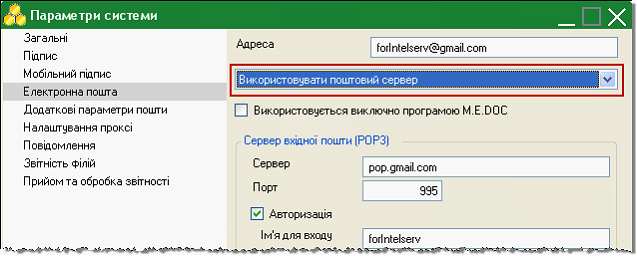

3. Оберіть розділ Додаткові параметри пошти.

4. Встановіть галочки в обох полях розділу та введіть адресу шлюза обміну документами.

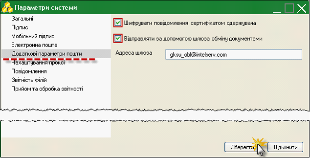

5. Збережіть внесені данні натиснувши на кнопку Зберегти.

6. У пункті Головного меню Довідники оберіть модуль Картка підприємства та далі розділ Державна установа.

7. Встановіть галочку у полі Підприємство – Державна установа.

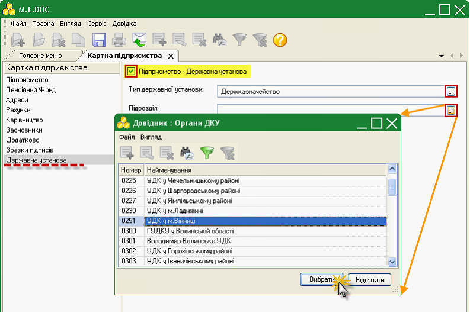

8. Вкажіть тип державної установи в однойменному полі – ДЕРЖКАЗНАЧЕЙСТВО, скориставшись кнопкою .

9. У полі Підрозділ оберіть потрібне значення із підключеного довідника Органи ДКУ.

10. Збережіть дані, скориставшись кнопкою  на панелі інструментів.

Після внесення всіх налаштувань, обов’язково виконайте прийом пошти (кнопка  на панелі інструментів або клавіша F9) для оновлення параметрів.

### Запуск підсистеми підготовки документів ДКСУ

_Шлях у довідці: Додатково: VATReturnInRst › Вхідні документи › Запуск підсистеми підготовки документів ДКСУ_

Для запуску підсистеми підготовки документів ДКСУ у Головному меню програми оберіть пункт Відшкодування ПДВ та далі подвійним натисканням лівої клавіші миші підрозділ Вхідні документи.

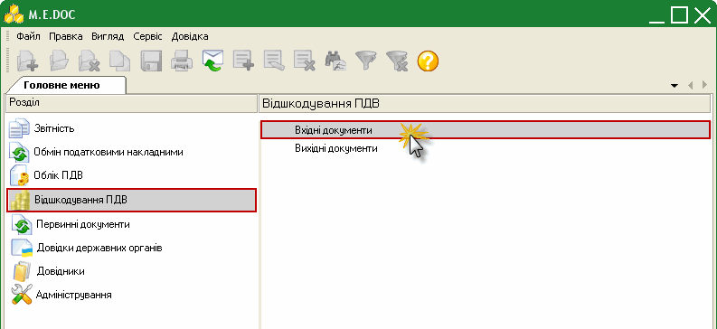

У окремій вкладці із назвою Відшкодування ПДВ відкриється модуль.

### Короткий опис модулю

_Шлях у довідці: Додатково: VATReturnInRst › Вхідні документи › Короткий опис модулю_

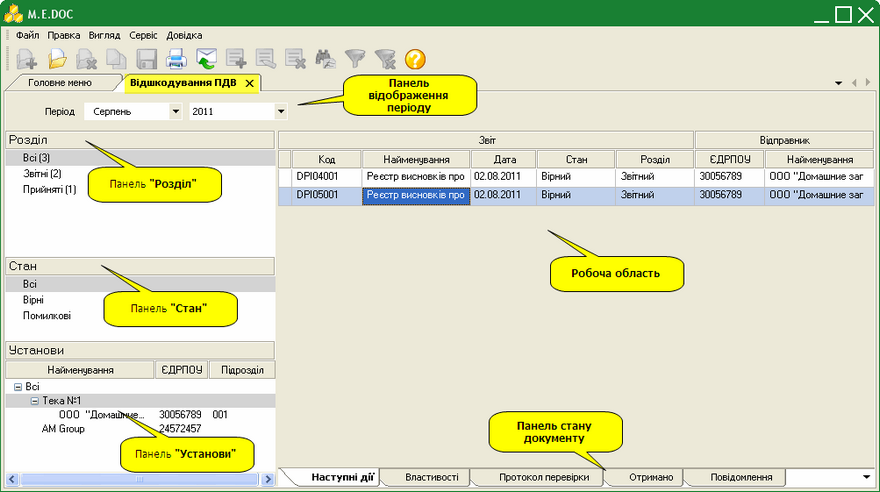

Робоча область

Містить безпосередньо записи реєстру: представлена у вигляді таблиці, окремий рядок якої відображає коротку основну інформацію реєстру висновків про відшкодування ПДВ. Переглянути більш детальніше документ та його склад можна у окремому вікні, яке відкривається подвійним кліком лівої клавіші миші по потрібному запису.

У лівій частині модулю розташована навігаційна панель. Панель містить розділи, що призначені для полегшення пошуку документів. При виборі певного розділу на панелі навігації, в робочій області відображаються документи, що відповідають заданим умовам фільтрації.

При роботі із реєстром документів відшкодування радимо користуватися даними фільтри для пошуку потрібних документів.

Панель відображення періоду

Призначена для вибору звітного періоду. Для початку роботи із модулем оберіть потрібний період із випадаючих списків:

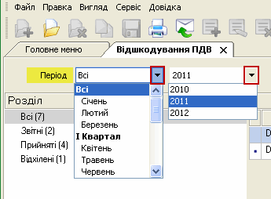

Панель «Розділ»

Документи в модулі розподілені по розділах:

- Всі – містить всі отримані електронними засобами зв’язку документи в межах обраного періоду;
- Прийняті – містить документи, які були оброблені внутрішніми засобами перевірки та в результаті перевірки не містять помилок. В результаті цього було автоматично сгенеровано Повідомлення про надходження документу та Квитанція №1 про прийом документу. Даний статус набувають документи, що надійшли від установи останніми в межах поточного періоду, тобто вони є актуальними;
- Звітні – містить прийняті документи, що надійшли раніше в межах поточного періоду, тобто вони є неактуальними;
- Відхилені – містить документи, які були оброблені внутрішніми засобами перевірки та в результаті перевірки містять виявлені помилки. В результаті цього було автоматично сгенеровано Повідомлення про надходження документу та Квитанція №1 про відхилення.

Панель «Стан»

Містить фільтри, що відповідають статусам документів:

- Всі – містить всі отримані електронними засобами зв’язку документи в межах обраного періоду;
- Вірні – містить документи, в яких в результаті обробки не виявлено помилок;
- Помилкові – містить документи, в яких в результаті обробки виявлено помилки.

Панель «Установи»

Відображає інформацію про відправників звітів. Також слугує фільтрами для пошуку документів в розрізі відправників в межах обраного періоду.

Панель стану документу

Панель стану документу призначена для відображення службової інформації щодо обраного документу. Панель розташована внизу вікна програмного комплексу та доступна як у відкритому документі, так і з реєстру документів (за умови виділення потрібного документу).

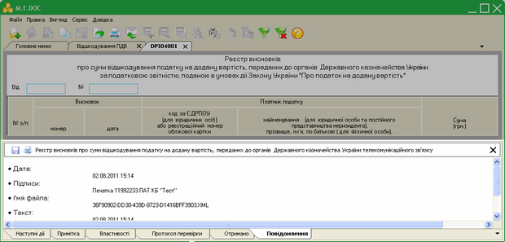

Натисніть на картинку, щоб збільшити її

Містить наступні вкладки:

- Наступні дії – містить інформацію щодо поточного стану документу, а також перелік можливих дій з документом у цьому стані. Слугує певною підказкою користувачу про доступні дії, які можна виконати з документом у певному стані.
- Примітка – текстове поле для внесення будь-якої інформації стосовно поточного документу. Дана вкладка доступна тільки у відкритому документі і тільки до моменту відправлення його засобами електронного зв’язку. У прийнятих документів дане поле заблоковано.
- Властивості – у режимі читання містить всю службову інформацію про документ, таку як: стан, період створення, дата та час останньої модифікації, інформація про сертифікати, якими підписано документ тощо. Інформація на цій вкладці постійно оновлюється та доповнюється при будь-яких змінах документу.
- Протокол перевірки – містить результати перевірки документу на наявність помилок.
- Отримано – дана вкладка містить службову інформацію що стосується отримання документу, таку як: реквізити відправника, дату та час отримання, текст документу у форматі xml тощо. При наявності непрочитаного повідомлення дана вкладка виділяється мерехтінням маркеру зліва від назви вкладки.
- Повідомлення – дана вкладка містить дату/час доставки та текст повідомлення. При наявності непрочитаного повідомлення дана вкладка виділяється мерехтінням маркеру зліва від назви вкладки.

### Функції підсистеми підготовки документів ДПСУ

_Шлях у довідці: Додатково: VATReturnInRst › Вхідні документи › Функції підсистеми підготовки документів ДПСУ_

#### Прийом документів електронним каналом зв’язку

_Шлях у довідці: Додатково: VATReturnInRst › Вхідні документи › Функції підсистеми підготовки документів ДПСУ › Прийом документів електронним каналом зв’язку_

Документи відшкодування ПДВ надходять як звичайна вхідна кореспонденція. Для цього потрібно натиснути кнопку на панелі інструментів  або функціональну клавішу F9.

Для доступу до електронної пошти необхідно підтвердження паролю печатки установи. У вікні Підпис, що відкрилось, вкажіть шлях до розміщення каталогу з секретними ключами та введіть пароль секретного ключа печатки установи у однойменні поля форми.

Якщо встановити галочку у полі «Зберігати пароль протягом сеансу», то при наступному підписанні даним сертифікатом в межах поточного сеансу користування дана процедура виконається автоматично.

Натисніть ОК для продовження.

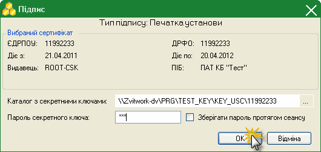

При наявності нових документів система повідомить про це:

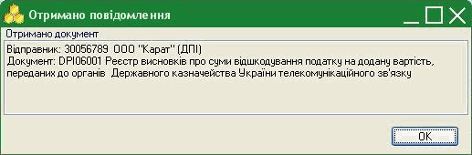

В момент прийому повідомлень в автоматичному режимі відбувається розшифрування одержаних документів, перевірка ЕЦП на легітимність. Далі перевіряється цілісності документів, формування та відправлення квитанцій про результат прийому (відхилення) документів.

Документи, що надійшли поміщаються у модуль Відшкодування ПДВ.

#### Відображення документів відшкодування ПДВ

_Шлях у довідці: Додатково: VATReturnInRst › Вхідні документи › Функції підсистеми підготовки документів ДПСУ › Відображення документів відшкодування ПДВ_

Для того, щоб відобразити (переглянути) отриманий реєстр висновків відшкодування ПДВ, його склад, виділіть потрібний документ та натисніть подвійним кліком лівої клавіші миші по ньому. Документ відкривається у окремому вікні.

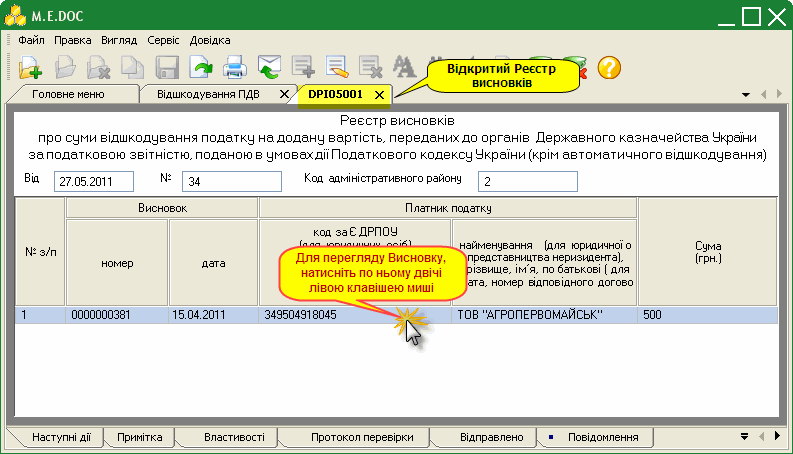

Для того, щоб відобразити (переглянути) висновок про суми відшкодування ПДВ, виділіть потрібний документ та натисніть подвійним кліком лівої клавіші миші по ньому. Документ відкривається у окремому вікні.

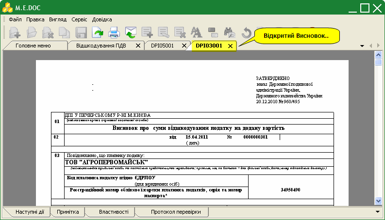

#### Експорт документів відшкодування ПДВ

_Шлях у довідці: Додатково: VATReturnInRst › Вхідні документи › Функції підсистеми підготовки документів ДПСУ › Експорт документів відшкодування ПДВ_

Для експорту реєстру документів відшкодування виділіть потрібний звіт або групу звітів. Процедура експорту запускається із меню Файл командою Експорт або із контекстного меню також командою Експорт.

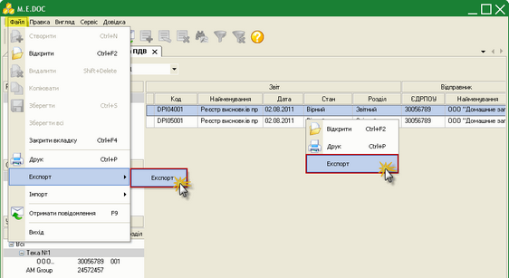

Натисніть на картинку, щоб збільшити її

Звичайним для операційної системи Windows способом вкажіть шлях до каталогу вивантаження документів. Натисніть ОК.

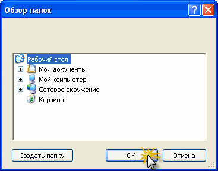

Система виведе повідомлення про завершення процесу експорту документів у файл Z21REEVS.DBF за вказаним шляхом:

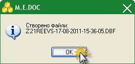

#### Друк документів відшкодування ПДВ (COPY)

_Шлях у довідці: Додатково: VATReturnInRst › Вхідні документи › Функції підсистеми підготовки документів ДПСУ › Друк документів відшкодування ПДВ (COPY)_

1. Відкрийте потрібний для друку чи перегляду документ подвійним натисканням лівої клавіші миші. Документ відкриється у окремій вкладці.

2. Для попереднього перегляду документу, що роздруковується у меню Правка оберіть опцію Електронна форма та зніміть галочку або натисніть функціональну клавішу F11.

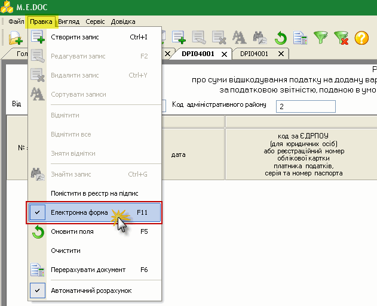

3. Документ змінить вигляд з електронної форми на документальну для попереднього перегляду.

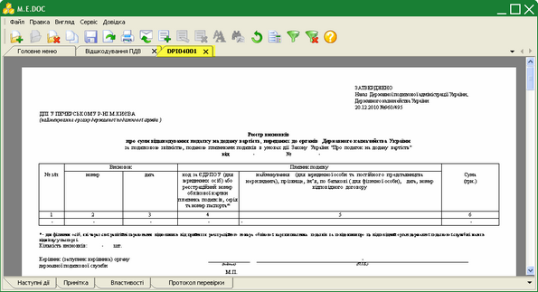

Натисніть на картинку, щоб збільшити її

4. Для друку документу натисніть кнопку  на панелі інструментів. Відкриється стандартне вікно Друк. Встановіть потрібні параметри та натисніть кнопку Друк.


