[← Зміст довідки](../)


# Вихідні документи

## Вихідні документи

_Шлях у довідці: Додатково: VATReturnOutRst › Вихідні документи_

Підсистема «АРМ підготовки документів ДПСУ» призначена для ведення реєстру документів відшкодування ПДВ шляхом імпорту даних із суміжної системи, затвердження та зашифрування документів засобами ЕЦП, відправки документів по електронним каналам зв’язку, а також прийом і відображення квитанцій про доставку документів.

У даному розділі довідки розглянуто наступне:

- [Налаштування, що потрібно виконати перед початком роботи із модулем](#vatreturnoutrst-ucdpsu_tools)
- [Запуск підсистеми підготовки документів ДПСУ](#vatreturnoutrst-ucdpsu_zapusk)
- [Короткий опис модулю](#vatreturnoutrst-ucdpsu_opys)
- Функції підсистеми підготовки документів ДПСУ

►

[Імпорт документів відшкодування ПДВ із суміжних систем](#vatreturnoutrst-ucdpsu_funkc_imp)

►

[Відображення документів відшкодування ПДВ](#vatreturnoutrst-ucdpsu_funkc_vid)

►

[Видалення документів відшкодування ПДВ](#vatreturnoutrst-ucdpsu_funkc_vyd)

►

[Друк документів відшкодування ПДВ](#vatreturnoutrst-ucdpsu_funkc_druk)

►

[Використання електронного цифрового підпису](#vatreturnoutrst-ucdpsu_funkc_ecp)

►

[Відправлення документів електронним каналом зв’язку](#vatreturnoutrst-ucdpsu_funkc_vidp)

►

[Прийом і відображення квитанцій про доставку документів](#vatreturnoutrst-ucdpsu_funkc_pryy)

►

[Експорт квитанцій у формат \*.dbf](#vatreturnoutrst-ucdpsu_funkc_exp)

### Налаштування, що потрібно виконати перед початком роботи із модулем

_Шлях у довідці: Додатково: VATReturnOutRst › Вихідні документи › Налаштування, що потрібно виконати перед початком роботи із модулем_

1. У пункті Головного меню Адміністрування оберіть модуль Параметри системи та далі розділ Електронна пошта.

2. Встановіть значення Використовувати каталоги, відправка та прийом зовнішньою програмою.
Далі вкажіть шлях до розміщення каталогів вхідних та вихідних повідомлень.

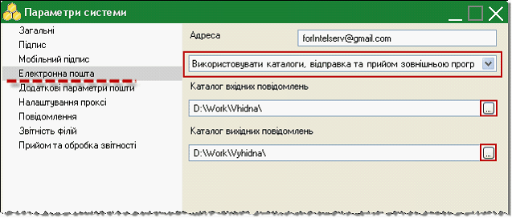

3. Оберіть розділ Додаткові параметри пошти.

4. Встановіть галочку у полі Відправляти за допомогою шлюза обміну документами.

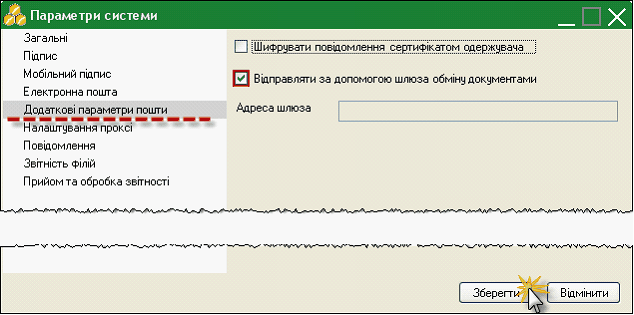

5. Збережіть внесені данні натиснувши на кнопку Зберегти.

6. У пункті Головного меню Довідники оберіть модуль Картка підприємства та далі розділ Державна установа.

7. Встановіть галочку у полі Підприємство – Державна установа.

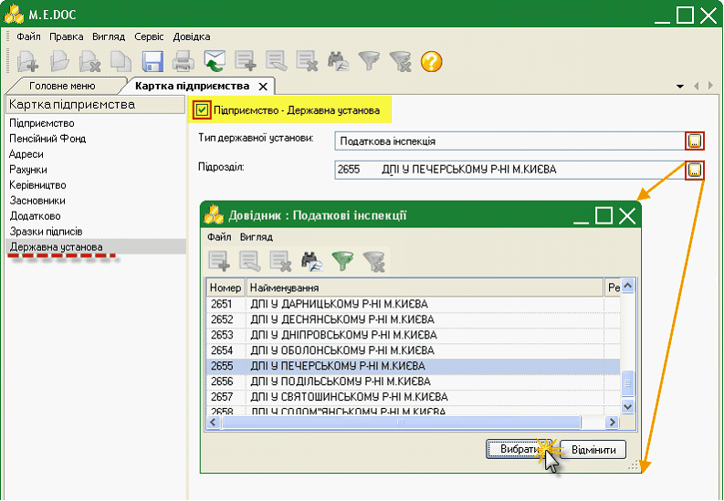

8. Вкажіть тип державної установи в однойменному полі – ПОДАТКОВА ІНСПЕКЦІЯ, скориставшись кнопкою .

9. У полі Підрозділ оберіть потрібне значення із підключеного довідника Податкові інспекції.

10. Збережіть дані, скориставшись кнопкою  на панелі інструментів.

Після внесення всіх налаштувань, обов’язково виконайте прийом пошти (кнопка  на панелі інструментів або клавіша F9) для оновлення параметрів.

### Запуск підсистеми підготовки документів ДПСУ

_Шлях у довідці: Додатково: VATReturnOutRst › Вихідні документи › Запуск підсистеми підготовки документів ДПСУ_

Для запуску підсистеми підготовки документів ДПСУ у Головному меню програми оберіть пункт Відшкодування ПДВ та далі подвійним натисканням лівої клавіші миші підрозділ Вихідні документи.

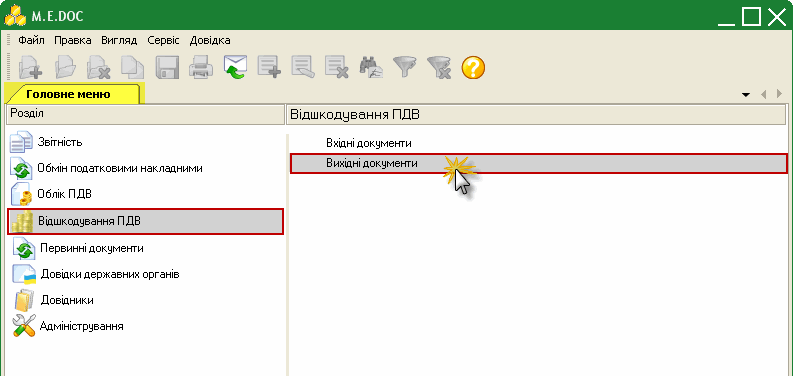

У окремій вкладці із назвою Відшкодування ПДВ відкриється модуль.

### Короткий опис модулю

_Шлях у довідці: Додатково: VATReturnOutRst › Вихідні документи › Короткий опис модулю_

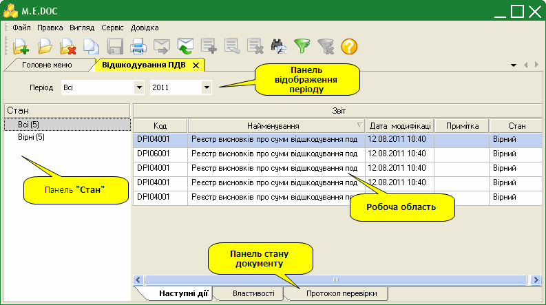

Робоча область

Містить безпосередньо записи реєстру: представлена у вигляді таблиці, окремий рядок якої відображає коротку основну інформацію реєстру висновків про відшкодування ПДВ. Переглянути більш детальніше документ та його склад можна у окремому вікні, яке відкривається подвійним кліком лівої клавіші миші по потрібному запису.

Панель відображення періоду

Призначена для вибору звітного періоду. Для початку роботи із модулем оберіть потрібний період із випадаючих списків:

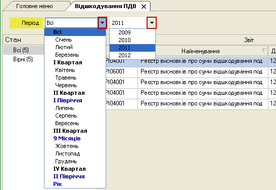

Панель «Стан»

Призначена для полегшення пошуку документів, містить фільтри, що відповідають статусам документів. При виборі певного статусу, в робочій області відображаються документи, що відповідають заданим умовам фільтрації:

- Всі – містить всі імпортовані документи в межах обраного періоду;
- Імпортовані – містить імпортовані у системі документи;
- На підпис бухгалтеру – містить документи, що були відправлені на підпис та очікують підписання сертифікатом ЕЦП з типом «Бухгалтер»;
- На підпис печаткою – містить документи, що були підписані сертифікатом бухгалтера та очікують підписання сертифікатом ЕЦП з типом «Печатка»;
- Готові до подачі – містить документи що були підписані сертифікатами бухгалтера та печаткою установи та очікують відправки у контролюючі органи;
- В дорозі – містить документи, що були відправлені у контролюючі органи та очікують обробки;
- Прийнято – містить документи, які було доставлено та оброблено у контролюючих органах (тобто отримано Повідомлення про доставку та Квитанція).

При роботі із реєстром документів відшкодування радимо користуватися даними фільтри для пошуку потрібних документів.

Панель стану документу

Призначена для відображення службової інформації щодо обраного документу. Панель розташована внизу вікна програмного комплексу та доступна як у відкритому документі, так і з реєстру документів (за умови виділення потрібного документу).

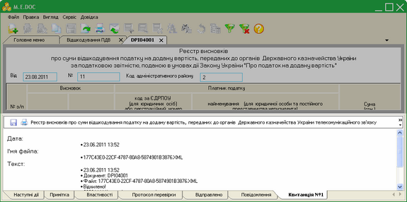

Натисніть на картинку, щоб збільшити її

Містить наступні вкладки:

- Наступні дії – містить інформацію щодо поточного стану документу, а також перелік можливих дій з документом у цьому стані. Слугує певною підказкою користувачу про доступні дії, які можна виконати з документом у певному стані.
- Примітка – текстове поле для внесення будь-якої інформації стосовно поточного документу. Дана вкладка доступна тільки у відкритому документі і тільки до моменту відправлення його засобами електронного зв’язку.
- Властивості – у режимі читання містить всю службову інформацію про документ, таку як: стан, період створення, дата та час останньої модифікації, інформація про сертифікати, якими підписано документ тощо. Інформація на цій вкладці постійно оновлюється та доповнюється при будь-яких змінах документу.
- Протокол перевірки – містить результати перевірки документу на наявність помилок. Дана вкладка знаходиться на панелі за замовчанням, у зв’язку з відсутністю можливості змін та перевірки імпортованих документів, дана вкладка не використовується.
- Відправлено – дана вкладка з’являється на панелі після відправлення документу адресату. Містить службову інформацію що стосується відправки документу, таку як: реквізити одержувача, дату та час відправлення, текст документу у форматі xml тощо.
- Повідомлення – дана вкладка з’являється на панелі після отримання повідомлення про доставку документу у контролюючий орган. Містить дату/час доставки та текст повідомлення. При наявності непрочитаного повідомлення дана вкладка виділяється мерехтінням маркеру зліва від назви вкладки.
- Квитанція №1 – дана вкладка з’являється на панелі після отримання квитанції. Містить датe/час доставки та текст квитанції. При наявності непрочитаної квитанції дана вкладка виділяється мерехтінням маркеру зліва від назви вкладки.

### Функції підсистеми підготовки документів ДПСУ

_Шлях у довідці: Додатково: VATReturnOutRst › Вихідні документи › Функції підсистеми підготовки документів ДПСУ_

#### Імпорт документів відшкодування ПДВ із суміжних систем

_Шлях у довідці: Додатково: VATReturnOutRst › Вихідні документи › Функції підсистеми підготовки документів ДПСУ › Імпорт документів відшкодування ПДВ із суміжних систем_

Для того, щоб імпортувати документи відшкодування ПДВ із суміжних систем, у меню Файл оберіть команду Імпорт документів відшкодування ПДВ.

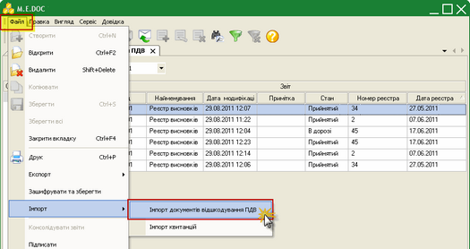

Натисніть на картинку, щоб збільшити її

Відкриється вікно Відкрити. Звичайним для операційної системи Windows способом оберіть каталог, де розташовано файл документу відшкодування ПДВ у форматі \*.dbf (з маскою Z21\*.DBF).

Виділіть файл курсором миші та натисніть кнопку Відкрити.

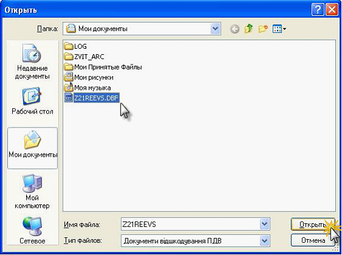

Розпочнеться процедура імпорту. По закінченню процедури, система виведе протокол імпорту даних. Документи поміщаються у модуль у певний звітний період та набувають стан Імпортовані.

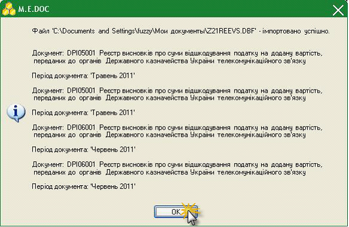

При імпорті з DBF-файлу, ті записи, які були проімпортовані, очищуються з вихідного файлу.

#### Відображення документів відшкодування ПДВ

_Шлях у довідці: Додатково: VATReturnOutRst › Вихідні документи › Функції підсистеми підготовки документів ДПСУ › Відображення документів відшкодування ПДВ_

Для того, щоб відобразити (переглянути) реєстр висновків відшкодування ПДВ, його склад, виділіть потрібний документ та натисніть подвійним кліком лівої клавіші миші по ньому. Документ відкривається у окремому вікні.

У відкритому документі Реєстру висновків розміщено поле Код адміністративного району, яке заповнюється із DBF-файлу із поля «C\_ADMRAJ». Дане поле призначено для швидкого орієнтування оператора, в який район ДКСУ відправляти звіт.

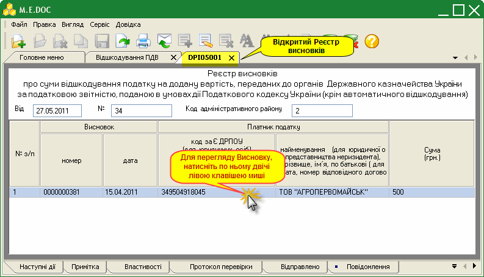

Для того, щоб відобразити (переглянути) висновок про суми відшкодування ПДВ, виділіть потрібний документ та натисніть подвійним кліком лівої клавіші миші по ньому. Документ відкривається у окремому вікні.

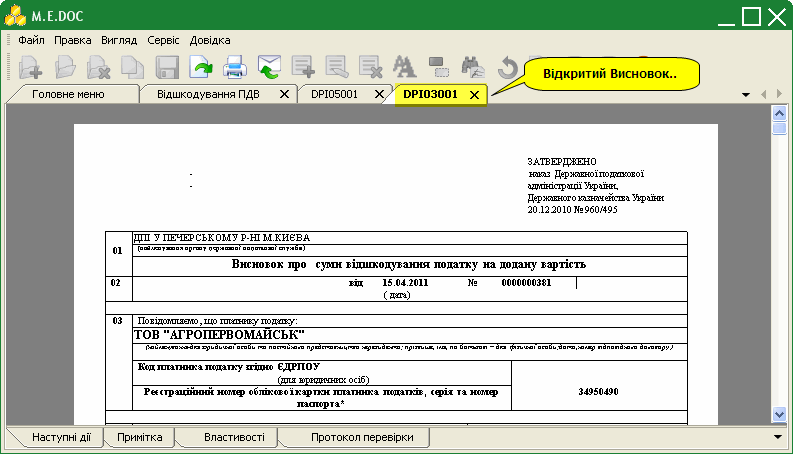

#### Видалення документів відшкодування ПДВ

_Шлях у довідці: Додатково: VATReturnOutRst › Вихідні документи › Функції підсистеми підготовки документів ДПСУ › Видалення документів відшкодування ПДВ_

Із реєстру висновків про відшкодування ПДВ можна видаляти документи, що були проімпортовані із суміжної системи, на будь-якому етапі підписання електронним цифровим підписом до моменту відправлення їх у контролюючі органи. Документи, що відправлені електронним каналам зв’язку блокуються від видалення.

Для того, щоб видалити, виділіть потрібний документ курсором миші або групу документів (рекомендуємо виділити перший файл та скористатися комбінацію клавіш Shift + стрілка вниз) та натисніть копку Видалити на панелі інструментів.

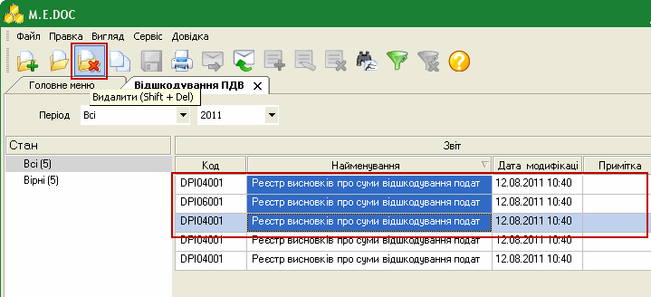

Система виведе запит підтвердження видалення файлів для попередження втрати даних. Натисніть Так.

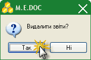

Після цього документи будуть видалені із реєстру.

#### Друк документів відшкодування ПДВ

_Шлях у довідці: Додатково: VATReturnOutRst › Вихідні документи › Функції підсистеми підготовки документів ДПСУ › Друк документів відшкодування ПДВ_

1. Відкрийте потрібний для друку чи перегляду документ подвійним натисканням лівої клавіші миші. Документ відкриється у окремій вкладці.

2. Для попереднього перегляду документу, що роздруковується у меню Правка оберіть опцію Електронна форма та зніміть галочку або натисніть функціональну клавішу F11.

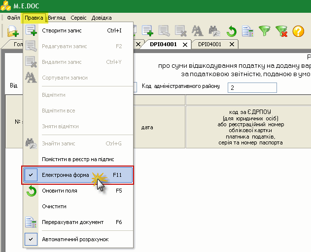

3. Документ змінить вигляд з електронної форми на документальну для попереднього перегляду.

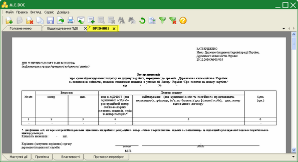

Натисніть на картинку, щоб збільшити її

4. Для друку документу натисніть кнопку  на панелі інструментів. Відкриється стандартне вікно Друк. Встановіть потрібні параметри та натисніть кнопку Друк.

#### Використання електронного цифрового підпису

_Шлях у довідці: Додатково: VATReturnOutRst › Вихідні документи › Функції підсистеми підготовки документів ДПСУ › Використання електронного цифрового підпису_

В цьому розділі:

[Управління сертифікатами відкритих ключів](#vatreturnoutrst-ucdpsu_funkc_ecp)

[Налаштування комплектів підписів](#vatreturnoutrst-ucdpsu_funkc_ecp)

[Підписання документів засобами ЕЦП](#vatreturnoutrst-ucdpsu_funkc_ecp)

Для здійснення електронного документообігу у ПК "M.E.Doc", необхідна наявність електронного цифрового підпису (ЕЦП), який використовується для ідентифікації автора і/або підписувача електронного документа іншими суб'єктами електронного документообігу.

Управління сертифікатами відкритих ключів

Отримані електронною поштою, збережені на зовнішньому електронному носії або на комп’ютері користувача в обраному каталозі сертифікати ЕЦП, необхідно завантажити у програму.

У Головному меню оберіть модуль Адміністрування та далі розділ Сертифікати. Для управління сформованими сертифікатами відкритого ключа ЕЦП використовується підрозділ Встановлені сертифікати. У таблиці підрозділу відображаються завантажені сертифікати ЕЦП поточної установи.

Сертифікати, термін дії яких закінчився, в таблиці виділяються червоним кольором.

Для завантаження сертифікатів у систему на панелі інструментів натисніть кнопку Створити запис.

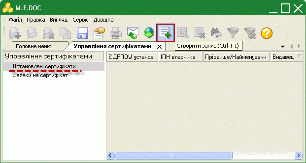

Відкриється вікно Відкрити. Звичайним для операційної системи Windows способом вкажіть шлях до каталогу, де зберігаються файли сертифікатів. Файли сертифікатів позначені піктограмою . Оберіть потрібний сертифікат (або декілька) та натисніть кнопку Відкрити.

Сертифікат(и) завантажиться у програму, і запис з його основними даними (код, прізвище отримувача чи найменування установи, ЄДРПОУ установи, видавець сертифікату, закінчення дії сертифікату та адреса E-mail) з’явиться в таблиці встановлених сертифікатів.

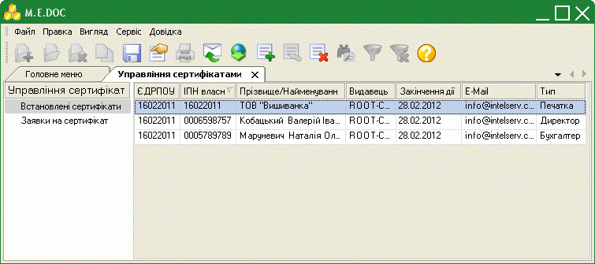

[Наверх](#vatreturnoutrst-ucdpsu_funkc_ecp)

Налаштування комплектів підписів

Для накладання підписів на документи відшкодування ПДВ попередньо необхідно налаштувати комплекти підписів відповідальних осіб. За умови наявності сертифіката ЕЦП у співробітника, йому можна надати право підписувати документи відшкодування. Також реалізовано можливість надання права рівнозначного підпису декільком співробітникам (з наявними сертифікатами). При підписанні документу, система запропонує обрати сертифікат особи серед сформованого в параметрах системи списку сертифікатів.

У Головному меню оберіть модуль Адміністрування та далі розділ Параметри системи. Комплекти підписів налаштовуються у підрозділі Підпис:

1. У блоці Комплект підписів оберіть тип Відшкодування ПДВ.

2. Під назвою типу, із випадаючого списку оберіть варіант комплекту накладання електронних підписів на документи посадовими особами: Директор - Печатка.

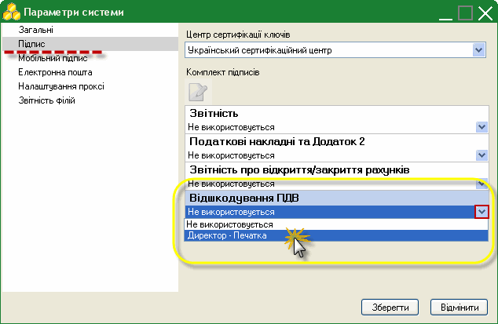

3. Нижче виведеться перелік всіх існуючих в системі сертифікатів з типом Співробітник та Печатка.

Для редагування списку підписантів, виділіть тип сертифікату, список якого потрібно змінити, та натисніть кнопку Змінити.

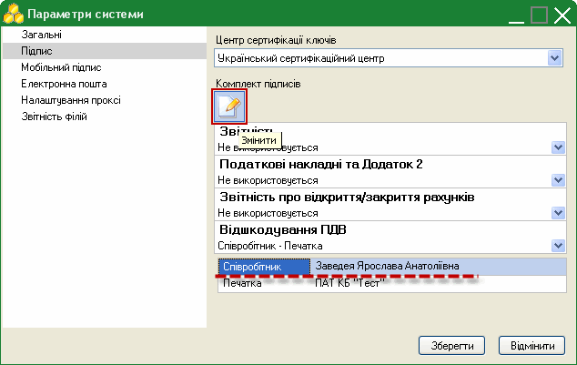

4. Відкриється окреме вікно Налаштування комплекту підписів. За допомогою кнопок Додати та Видалити відредагуйте список за власних потреб.

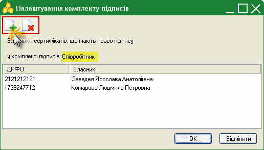

5. При підписанні документу буде виводитись список заданих відповідальних осіб.

[Наверх](#vatreturnoutrst-ucdpsu_funkc_ecp)

Підписання документів засобами ЕЦП

Для роботи з усіма сертифікатами у програмі використовується універсальна бібліотека, тому процедура підпису для всіх сертифікатів однакова.

Підписати документи можна із реєстру документів відшкодування  при цьому способі можна підписувати групу документів, або безпосередньо із відкритого документу – тільки обраний документ:

1. Для накладання цифрових підписів із реєстру документів відшкодування виділіть потрібний для підпису звіт або групу звітів. Процедура підпису задається програмно в регламентованій послідовності і запускається із меню Файл командою Підписати або із контекстного меню також командою Підписати.

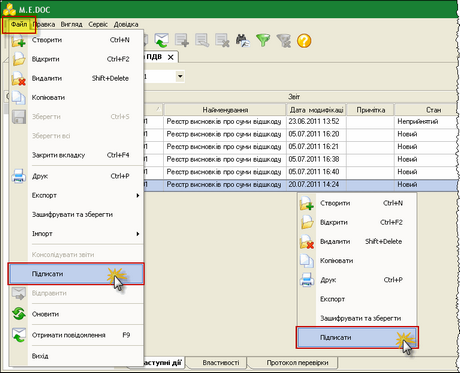

Натисніть на картинку, щоб збільшити її

2. Для накладання цифрового підпису із документу, на панелі стану документу, у закладці Наступні дії оберіть опцію Передати звіт на підпис.

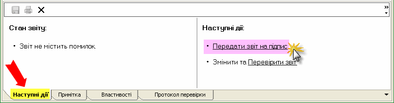

Відкриється вікно Підпис, тип підпису Співробітник. У вікні представлений список сертифікатів посадових осіб, що був сформований при налаштуванні комплектів підписів. Необхідно обрати сертифікатом саме якої особи підписати даний документ. Далі вкажіть шлях до розміщення каталогу з секретними ключами та введіть пароль секретного ключа відповідної посадової особи у однойменні поля форми.

Якщо встановити галочку у полі «Зберігати пароль протягом сеансу», то при наступному підписанні даним сертифікатом в межах поточного сеансу користування дана процедура виконається автоматично.

Натисніть ОК для продовження.

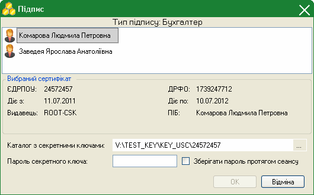

Згідно з налаштованим комплектом підписів наступним кроком потрібно підписати документ Печаткою установи. Процедура підписання печаткою аналогічна описаній вище, за винятком вибору сертифікату.

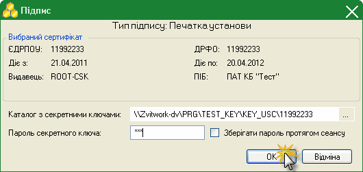

[Наверх](#vatreturnoutrst-ucdpsu_funkc_ecp)

#### Відправлення документів електронним каналом зв’язку

_Шлях у довідці: Додатково: VATReturnOutRst › Вихідні документи › Функції підсистеми підготовки документів ДПСУ › Відправлення документів електронним каналом зв’язку_

Після того, як документ був підписаний згідно з налаштованим комплектом підписів, на панелі стану документу стає доступною опція Подати у контролюючий орган.

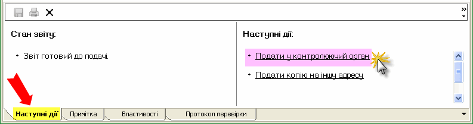

На виконання цієї команди, система повторно запропонує підписати файл сертифікатом печатки установи - таким чином підписується "конверт", в який поміщається файл для відправки.

Якщо при підписанні печаткою установи раніше була встановлена галочка у полі «Зберігати пароль протягом сеансу», то дана процедура виконається автоматично (в межах поточного сеансу користування).

Відкриється вікно Вибір адресата. Оберіть адресу органів ДКСУ. Для користувачів, які відправляють звіти у різні райони ДКСУ, є можливість при відправці обрати потрібний район.

- Якщо напроти назви потрібного району у колонці «Адреса» відсутнє значення, відправка документу не відбудеться. Дочекайтесь, поки заповниться відповідне значення! Це поле заповнюється за наявними даними при перевірці пошти.

Примітка:

Вибір адресата відбувається тільки при першому відправлені документу. Система запам’ятовує вказані параметри та використовує їх надалі при відправленні документів.

Повідомлення відправлено. При цьому, на панелі стану документу з’явиться додаткова вкладка Відправлено, що містить інформацію про код та назву одержувача звіту, адресу одержувача, дата та час відправлення тощо.

#### Прийом і відображення квитанцій про доставку документів

_Шлях у довідці: Додатково: VATReturnOutRst › Вихідні документи › Функції підсистеми підготовки документів ДПСУ › Прийом і відображення квитанцій про доставку документів_

Як тільки в органах Державного казначейства був прийнятий звіт, генерується Повідомлення про прийом документу та Квитанція з результатами обробки звіту, які надсилаються відправникові.

Повідомлення та квитанція надходять як звичайна вхідна кореспонденція. Для цього потрібно натиснути кнопку на панелі інструментів  або функціональну клавішу F9. При наявності відповідей система повідомить про це.

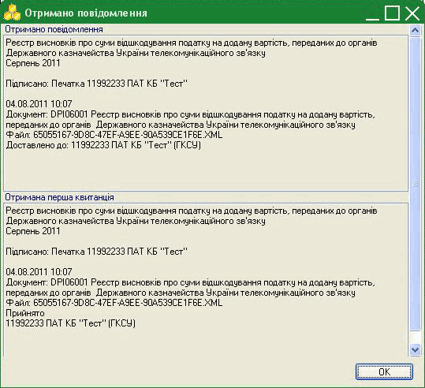

Файли Повідомлення та Квитанції прикріпляються до документу, що відправлявся. Вміст прийнятих Повідомлення та Квитанції можна переглянути на панелі стану документу, де з’являються додаткові вкладки Повідомлення та Квитанція №1 відповідно.

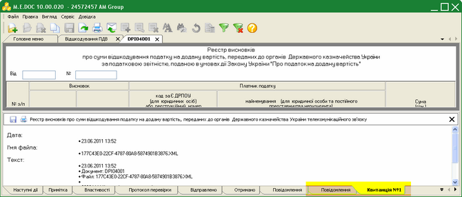

Натисніть на картинку, щоб збільшити її

#### Експорт квитанцій у формат *.dbf

_Шлях у довідці: Додатково: VATReturnOutRst › Вихідні документи › Функції підсистеми підготовки документів ДПСУ › Експорт квитанцій у формат *.dbf_

1. Відкрийте документ (Реєстр висновків), квитанцію якого потрібно вивантажити з програмного комплексу, подвійним натисканням лівої клавіші миші. Документ відкриється у окремій вкладці.

2. На панелі стану документу відкрийте вкладку Квитанція №1.

3. Натисніть кнопку Зберегти.

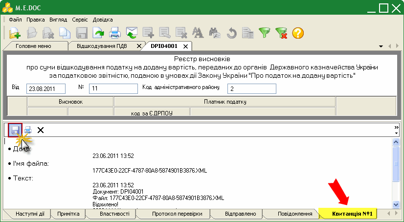

4. Звичайним для операційної системи Windows способом вкажіть шлях до каталогу вивантаження квитанцій. Натисніть ОК.

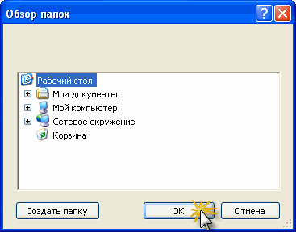

5. Система виведе повідомлення про завершення процесу експорту квитанції у файл RCVKVT.DBF за вказаним шляхом:

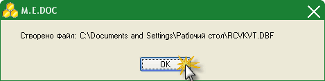

Якщо обсяг тексту перевищує 250 символів, створюється декілька записів з однаковими реквізитами і різними номерами порцій.


