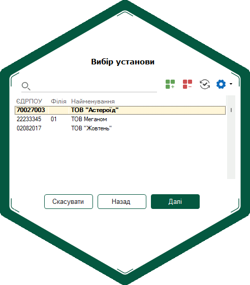
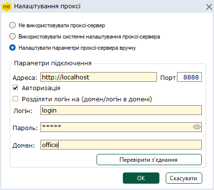

[← Зміст довідки](../)


# Вибір установи

## Вибір установи

_Шлях у довідці: Вступ › Встановлення, запуск та налаштування програми › Вибір установи_

Кожного разу при вході в програму необхідно обрати підприємство, з яким розпочинається робота. У вікні Вибір установи представлено перелік всіх [доданих](Connect_org.html#connect_org-connect_org) в програмний комплекс підприємств. Це саме вікно відкривається й при [зміні підприємства](Help.html#help-setup_end_2).

За допомогою кнопок вікна ви можетеї:

- Назад – повернутися до вікна авторизації;
- Далі – відкрити обране підприємство;
- Скасувати – завершити роботу з програмою.

У вікні вибора установи передбачено наступні функції:

Додавання та видалення підприємства

Початок роботи в програмному комплексі, після його встановлення, відбувається з додавання підприємства в систему.

Так, в програмі можна створити нове підприємство або відновити з резервної копії вже існуюче підприємство.

Для того, щоб додати підприємство натисніть кнопку  на панелі інструментів.

Детально про додавання нового підприємства в програму див. в розділі [Додавання підприємства](Connect_org.html#connect_org-connect_org).

Відповідно, за потреби будь-яке підприємство можна видалити з програми. Для цього натисніть кнопку  на панелі інструментів.

Увага!
Відновити видалене підприємство без попередньо створених резервних копій неможливо!

Оновлення програми

Дана функція доступна тільки для локальної версії програми.

Для оновлення програми натисніть кнопку  на палені інструментів або у вікні вибору установи під час запуску програми. Якщо оновлення відсутні, кнопка має вигляд .

Для скорочення часу оновлення та зменшення інтернет-трафіку впроваджено кумулятивні оновлення, що об’єднують зміни у програмі, виконані за певний період часу. Система аналізує наявність кумулятивних оновлень та їх доступність для встановленої версії програми.

Якщо доступні кумулятивні оновлення знайдені, вони автоматично завантажаться одним пакетом. Якщо ж для встановленої версії кумулятивне оновлення недоступне, завантажуватимуться окремі пакети оновлень.

Процес завантаження оновлень відображається у окремому вікні. Після завантаження всіх доступних пакетів ви можете приступити до встановлення оновлень, або відкласти встановлення.

У разі потреби можливо перервати процес завантаження файла оновлення. Для цього у вікні Оновлення програмного забезпечення натисніть кнопку Відмінити. Процес завантаження припиниться. У рядку версії оновлення, завантаження якого було припинено, відображається червона позначка. Після припинення завантаження ви можете:

- повторити завантаження оновлення, натиснувши кнопку Повторити;
- повернутись до списку доступних оновлень, натиснувши кнопку Назад.

Оновлення завантажуються з ресурсу https://load.medoc.ua.

Пошук потрібного підприємства

Для користувачів, які ведуть багато підприємств в програмному комплексі надані інструменти пошуку потрібного підприємства.

Щоб знайти підприємство почніть вводити його назву або код ЄДРПОУ у полі Пошук.

У вікні будуть відображені лише ті підприємства, що містять введені символи.

Додавання ліцензії

Передбачена можливість вводу ліцензійного коду для підприємства.

Для цього виділіть потрібне підприємство в переліку установ та натисніть кнопку  , оберіть пункт Ліцензія. У вікні Керування ліцензіями введіть код.

Детально про ліцензійний код до програми див. в розділі [Керування ліцензіями](FormLicInfo.html#formlicinfo-admlic) даної довідки.

Сховати підзвітні установи

Дана функція доступна тільки в режимі M.E.Doc.Корпорація.

Призначено для полегшення пошуку Головної установи у переліку установ. Для того, щоб сховати підзвітні установи, натисніть кнопку  та оберіть пункт Сховати підзвітні установи.

Налаштування проксі

Для здійснення оновлення програми, система автоматично перевіряє з'єднання з мережею Інтернет. В разі відсутності прямого підключення до Інтернету, необхідно налаштувати параметри підключення до проксі-сервера.

Для того, щоб налаштувати проксі, натисніть кнопку  та оберіть команду Налаштування проксі.

Відкриється вікно Налаштування проксі.

Виможете використати системні налаштування проксі-сервера, встановивши відповідну опцію, або налаштувати параметри проксі-серверу вручну:

1. Оберіть опцію Налаштувати параметри проксі-серверу вручну.

2. У полі Адреса вкажіть доменне ім'я або IP-адресу проксі-сервера.

3. У полі Порт вкажіть номер порту, який використовується проксі-сервером для підключень (за умовчанням встановлено значення 3128).

4. За умови використання авторизованого доступу до мережі Інтернет, встановіть опцію Авторизація, введіть особисті дані користувача в поля Логін і Пароль та за необхідності Домен.

При використанні доменного доступу передбачена можливість автоматичного розподілу по полям введеного Логіну на ім'я домену та логін.
Для цього встановіть позначку в полі Розбивати логін на (домен/логін).
Тепер введіть в поле Логін значення, використовуючи наступний формат:
<ім'я домену>\<логін> або <логін>@<ім'я домену>.

5. Для перевірки правильності введених даних натисніть на кнопку Перевірити з'єднання. Система повідомить про успішне з'єднання або помилку.


