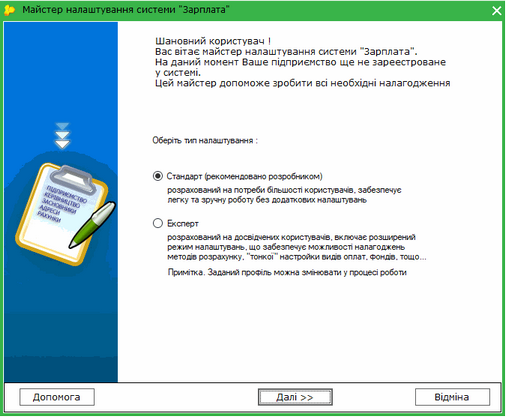
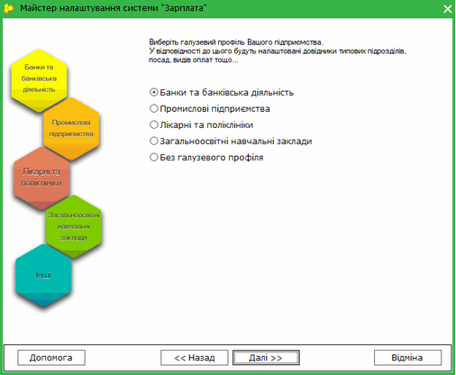
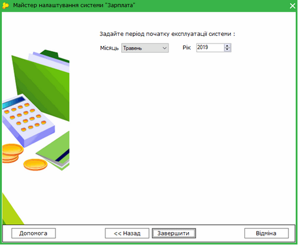

[← Зміст довідки](../)


# Перший запуск системи "Зарплата"

## Перший запуск системи "Зарплата"

_Шлях у довідці: Розділи програми › Зарплата › Перший запуск системи "Зарплата"_

При першому запуску модулю відкривається Майстер налаштування. Майстер допоможе зареєструвати підприємство в системі, обрати потрібний галузевий профіль, відповідно до якого будуть налаштовані довідники.

1. Оберіть тип налаштування:

- Стандарт - саме цей режим рекомендує використовувати розробник програмного комплексу, він розрахований на потреби більшості користувачів, дозволяє працювати із системою без додаткових налаштувань.
- Експерт - режим призначений для досвідчених користувачів, містить розширений набір налаштувань, що забезпечує можливості програмування методів розрахунку,  налагодження нових видів оплат, фондів тощо.

Натисніть, щоб збільшити малюнок

Натисніть кнопку Далі.
Для скасування Майстра натисніть Відміна.

2. Оберіть галузевий профіль, до якого відноситься Ваше підприємство.
На підставі обраного профілю будуть налаштовані довідники вашого програмного комплексу.

Натисніть, щоб збільшити малюнок

Натисніть кнопку Далі.
Для повернення до попереднього кроку натисніть Назад.
Для скасування Майстра натисніть Відміна.

3. Вкажіть місяць та рік, з якого плануєте розпочати вести роботу в програмі - початок промислової експлуатації системи. Розрахунок заробітної плати буде проводитись з обраного місяця.

Натисніть, щоб збільшити малюнок

Натисніть кнопку Завершити.

Система налаштована та готова до експлуатації!


